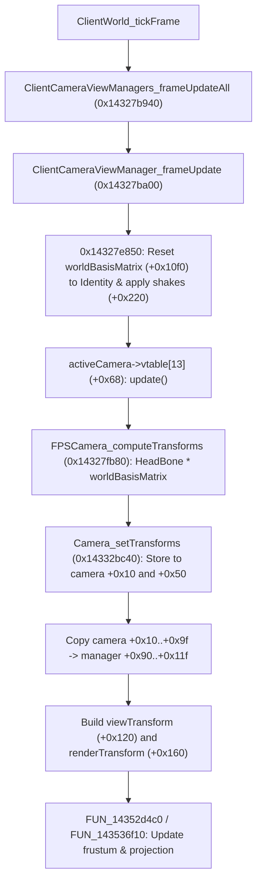

# Camera View Matrix Decoupling & 6-DOF Freedom

This document reverse-engineers the camera view matrix generation pipeline, the active camera hierarchy (`FPSCamera`, `FreeCamera`, `CameraObject`), and the root cause of view flipping when wall-walking, ceiling-walking, or undergoing non-standard gravity. It provides the architectural blueprint for full 6-DOF orientation (including roll) and camera basis decoupling in Frostbite.

---

## 1. Executive Summary & Root Cause Analysis

### The Problem
When Faith runs on vertical walls, walks on ceilings (using altered gravity vectors via `hknpCharacterProxy`), or enters extreme rotational postures, the camera violently snaps, flips upside down, or becomes trapped in gimbal lock.

### The Root Cause
1. **Global Y-Up Enforcement in View Manager Modifiers (`0x14327e850`)**:
   Every frame, before calling the camera update, `ClientCameraViewManager_frameUpdate` (`0x14327ba00`) calls `FUN_14327e850(&manager->field_0x220, &manager->worldBasisMatrix, ...)`:
   - It re-initializes `manager->worldBasisMatrix` (`manager + 0x10f0`) to an exact **identity matrix**:
     $$\mathbf{M}_{\text{worldBasis}} = \begin{bmatrix} 1 & 0 & 0 & 0 \\ 0 & 1 & 0 & 0 \\ 0 & 0 & 1 & 0 \\ 0 & 0 & 0 & 1 \end{bmatrix}$$
   - Its up vector is hardcoded to $\hat{y} = (0, 1, 0)$.
   - Camera shakes and rotational tilts (from the red-black tree at `manager + 0x220`) are multiplied into this matrix, but its origin remains world-space $(0, 1, 0)$.

2. **First-Person Camera Transform Synthesis (`0x14327fb80`)**:
   In `FPSCamera_computeTransforms` (`0x14327fb80`, vtable slot `+0x70`):
   - The camera queries the character's head-tracking provider at `FPSCamera + 0x150` via `vtable[3]` (`+0x18`) to retrieve the local head bone transform $\mathbf{T}_{\text{head}}$.
   - It then multiplies $\mathbf{T}_{\text{head}}$ by `manager->worldBasisMatrix` (`manager + 0x10f0`).
   - If Faith's body is standing on a vertical wall ($-\hat{g} = (1, 0, 0)$) or ceiling ($-\hat{g} = (0, -1, 0)$), her physical proxy up vector $\hat{u}$ is perpendicular or opposite to world Y, but the camera basis projection projects against $(0, 1, 0)$.
   - Furthermore, the frustum generator (`FUN_14352d4c0` / `FUN_143536f10`) clamps pitch within $[-89^\circ, +89^\circ]$ relative to the matrix's Y-up axis, inducing gimbal singularities and 180-degree roll-flips.

---

## 2. Complete Camera Architecture & Vtable Layouts

### A. Camera Hierarchy
```
fb::CameraObject (0xb0 base)
  ├── fb::FPSCamera (0x190, vtable 0x141b18e58, type enum 5)
  └── fb::FreeCamera (0x210, vtable 0x141b18c78, type enum 3)
        └── fb::DemoRecorderCamera
```

### B. `CameraObject` Layout
| Offset | Type | Name | Description |
|---|---|---|---|
| `+0x00` | `void*` | `vtable` | Polymorphic camera vtable (`0x141b18e58` or `0x141b18c78`) |
| `+0x08` | `int32_t` | `refCount` | Atomic reference counter (`AddRef` / `Release`) |
| `+0x10` | `LinearTransform` | `transform` | Primary camera view transform (right, up, forward, translation) |
| `+0x50` | `LinearTransform` | `viewTransform` | Secondary transform copy (interpolated / render mesh) |
| `+0x90` | `Vec3` / `Vec4` | `velocity` | Linear velocity delta (zeroed in `FreeCamera_setTransforms`) |
| `+0xac` | `float` | `baseFovYDegrees` | Vertical field of view before user FOV setting (default 55.0f) |
| `+0xf8` | `void*` | `headTrackProvider` | Head tracking provider (FPSCamera) |
| `+0x150` | `void*` | `controller` | Controller / animation bone provider (`FPSCamera`) |
| `+0x160` | `void*` | `parentTransform` | Vehicle / world parent transform (`FPSCamera`) |

### C. Camera Vtable Slots
| Slot | Offset | Function | Implementation (`FPSCamera`) | Implementation (`FreeCamera`) |
|---|---|---|---|---|
| `vf0` | `+0x00` | `getType()` | `0x14327a400` (`&TI_FPSCamera`) | `0x14327a400` (`&TI_FreeCamera`) |
| `vf1` | `+0x08` | `AddRef()` | `0x143a56370` | `0x143a56370` |
| `vf2` | `+0x10` | `Release()` | `0x142fa2b70` | `0x142fa2b70` |
| `vf3` | `+0x18` | `~Camera()` | `FPSCamera::~FPSCamera` | `0x143275f30` (`FreeCamera::~FreeCamera`) |
| `vf7` | `+0x38` | `getFov()` | Returns float FOV offset | Returns float FOV offset |
| `vf8` | `+0x40` | `getSettings()` | Returns camera settings ptr | Returns camera settings ptr |
| `vf13` | `+0x68` | `update()` | `0x14327bd80` (`FPSCamera_update`) | `0x142a1c590` (nullsub) |
| `vf14` | `+0x70` | `computeTransforms()` | `0x14327fb80` (`FPSCamera_computeTransforms`) | `0x14332d780` (`FreeCamera_computeTransforms`) |
| `vf16` | `+0x80` | `getName()` | `0x14327e7f0` (`"FPSCamera"`) | `0x14327e810` (`"FreeCamera"`) |
| `vf17` | `+0x88` | `getCameraType()` | `0x142d8c780` (returns `5`) | `0x142ba3d90` (returns `3`) |

---

## 3. `ClientCameraViewManager` Transform Flow

The view manager (`ClientCameraViewManager`, size `0x1ba0`, global `0x142415e50`) orchestrates camera updates across three sequential phases:



### Key View Manager Offsets
| Offset | Type | Name | Purpose |
|---|---|---|---|
| `+0x20` | `float` | `aspect` | Aspect ratio (1.77778 for 16:9) |
| `+0x80` | `float` | `fovYDegrees` | Computed vertical FOV |
| `+0x90` | `LinearTransform` | `transform` | Primary camera transform (MECMP: looks along $-\text{forward}$) |
| `+0xd0` | `LinearTransform` | `transformCopy` | Secondary transform copy |
| `+0x120` | `LinearTransform` | `viewTransform` | View matrix constructed each frame |
| `+0x160` | `LinearTransform` | `renderTransform` | Final render transform copied to GBuffer / rasterizer |
| `+0x208` | `CameraObject*` | `activeCamera` | Currently active camera (`FPSCamera` or `FreeCamera`) |
| `+0x220` | `eastl::rbtree` | `modifiersTree` | Active camera shakes, recoil offsets, and tilts |
| `+0x10f0` | `LinearTransform` | `worldBasisMatrix` | Identity basis matrix updated by `0x14327e850` |
| `+0x1130` | `void*` | `cameraSettingsBlend` | Active camera post-processing & blend state |
| `+0x1140` | `void*` | `viewParameters` | View frustum parameters |
| `+0x1660` | `void*` | `frustum` | View frustum / projection matrix struct |
| `+0x1b8e` | `uint8_t` | `updating` | Active flag (1 = update, 0 = idle) |
| `+0x1b90` | `void*` | `postUpdateListeners` | Singly linked list of post-simulation listener callbacks |

---

## 4. 6-DOF Freedom & Wall/Ceiling Walking Decoupling

To decouple the camera and achieve complete 6-DOF freedom (arbitrary roll angles $\phi \in [-180^\circ, 180^\circ]$, inverted view vectors, and surface-aligned wall/ceiling running), three distinct decoupling strategies are available:

### Strategy 1: GridNode `camera_set` / Vtable Decoupling (Production-Ready)
GridNode's layout engine already implements a per-object vtable swap on `activeCamera` (`sdk/src/layouts.cpp`):
- Replaces `activeCamera->vtable` with `g_camFakeVtbl`.
- Hooks slot `+0x68` (`camFrameUpdate`) and slot `+0x70` (`camOutput`).
- When a mod calls `gn::camera_set(const gn_transform* t, uint32_t flags)`:
  - `camOutput` overrides the output of `FPSCamera_computeTransforms` directly in `out[0]` and `out[1]`.
  - `camFrameUpdate` stores `t` directly to `camera + 0x10` and `camera + 0x50`.
  - The view manager copies `t` to `+0x90`, `+0x120`, and `+0x160`.
  - **Result**: No pitch clamp, full roll angle injection, completely decouples camera orientation from world $(0, 1, 0)$!

### Strategy 2: Proxy Surface Up-Vector Injection via `worldBasisMatrix` (`+0x10f0`)
For first-person gameplay where the camera must naturally track Faith's body on walls and ceilings without fully manual freecam control:
1. Every frame, immediately after `0x14327e850` executes (or via a hook on `ClientCameraViewManager_frameUpdate`):
2. Read Faith's physical proxy up-vector $\hat{u} = \text{hknpCharacterProxy} + 0xd0$ (which equals $-\frac{\mathbf{g}}{\|\mathbf{g}\|}$).
3. When Faith is on a wall with surface normal $\hat{n}$, $\hat{u} = \hat{n}$.
4. Construct an orthonormal basis matrix $\mathbf{M}_{\text{surface}}$:
   $$\hat{u} = \hat{n}_{\text{surface}}$$
   $$\hat{r} = \frac{\hat{f}_{\text{proxy}} \times \hat{u}}{\|\hat{f}_{\text{proxy}} \times \hat{u}\|}$$
   $$\hat{f} = \hat{u} \times \hat{r}$$
   $$\mathbf{M}_{\text{surface}} = \begin{bmatrix} \hat{r}_x & \hat{r}_y & \hat{r}_z & 0 \\ \hat{u}_x & \hat{u}_y & \hat{u}_z & 0 \\ \hat{f}_x & \hat{f}_y & \hat{f}_z & 0 \\ 0 & 0 & 0 & 1 \end{bmatrix}$$
5. Write $\mathbf{M}_{\text{surface}}$ into `manager + 0x10f0`.
6. When `FPSCamera_computeTransforms` (`0x14327fb80`) multiplies $\mathbf{T}_{\text{head}} \times \mathbf{M}_{0x10f0}$, the camera automatically tracks with Faith's wall-running or ceiling orientation with zero flipping!

### Strategy 3: Component Override Transform Property (`0x846f73f0`)
In `ClientCameraComponent` (`0x141b0a298`):
- The component registers property handler for hash `0x846f73f0` (`OverrideTransform`).
- When this property is dispatched, it sets bit 5 (`0x20`) in `field_0x1bc` and stores the 64-byte `LinearTransform` at `component + 0x90`.
- The engine camera system then uses this transform directly, bypassing the head-bone update.

---

## 5. Input Concept IDs for Camera Control

From `InputConceptId::toString()` (`0x14468ca20`), the engine's built-in camera concept IDs are:

| Concept ID | String Identifier | Usage |
|---|---|---|
| `0x49` | `ConceptCameraPitch` | Player camera pitch (mouse Y / right stick Y) |
| `0x4a` | `ConceptCameraYaw` | Player camera yaw (mouse X / right stick X) |
| `0x78` | `ConceptFreeCameraRotateX` | Free camera pitch |
| `0x79` | `ConceptFreeCameraRotateY` | Free camera yaw |
| `0x7a` | `ConceptFreeCameraRotateZ` | Free camera roll (Z rotation) |
| `0x7b` | `ConceptFreeCameraIncreaseSpeed` | Increase flight speed |
| `0x7c` | `ConceptFreeCameraDecreaseSpeed` | Decrease flight speed |
| `0x7d` | `ConceptFreeCameraFOVModifier` | FOV modifier hold |
| `0x7e` | `ConceptFreeCameraChangeFOV` | FOV scroll wheel adjust |

---

## 6. In-Game Verification Test Plans

### Test 1: Full 6-DOF Roll Injection Verification
1. Activate camera override via `gn::camera_set(&t, GN_CAMERA_BODY)`.
2. Continuously increment roll angle $\phi$ from $0^\circ$ to $360^\circ$ at $45^\circ/\text{sec}$.
3. Verify that the rendered view rotates smoothly around the look axis without snapping or flipping at $90^\circ$, $180^\circ$, or $270^\circ$.

### Test 2: Wall-Walking Surface Alignment Verification
1. Apply horizontal gravity $\mathbf{g} = (9.81, 0, 0)$ via `gn::gravity_set` so Faith walks on a vertical wall.
2. Inject surface normal basis $\mathbf{M}_{\text{surface}}$ into `ClientCameraViewManager + 0x10f0`.
3. Verify that the first-person camera smoothly tracks the wall as a floor without flipping upside down.

### Test 3: Head-Track Shake Decoupling
1. Run Faith into heavy landing / roll animation.
2. Read raw head track provider transform at `FPSCamera + 0x150`.
3. Filter out the high-frequency roll oscillations before writing to `camera + 0x10`.
4. Verify that motion sickness / camera roll during parkour landings can be eliminated while retaining translation.
