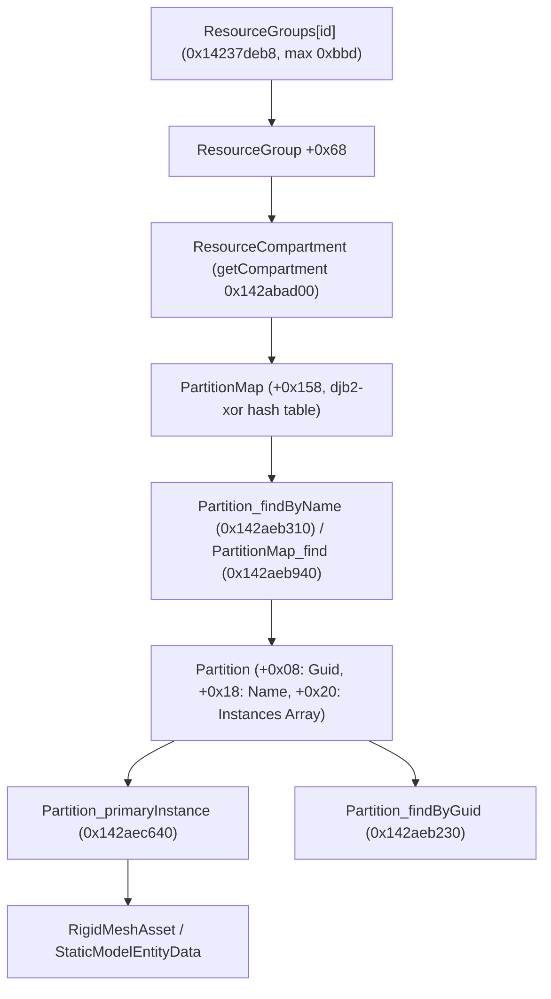
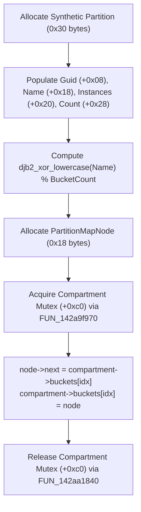
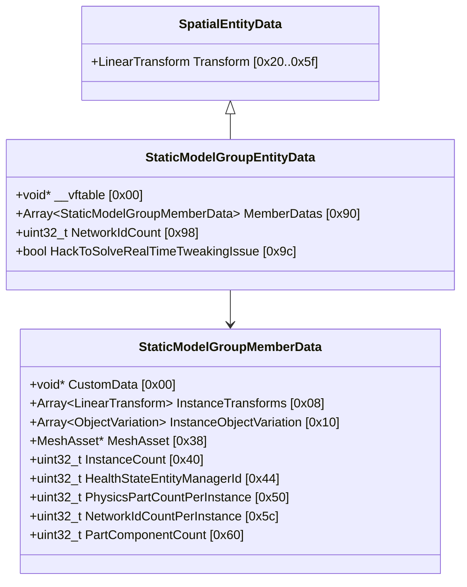
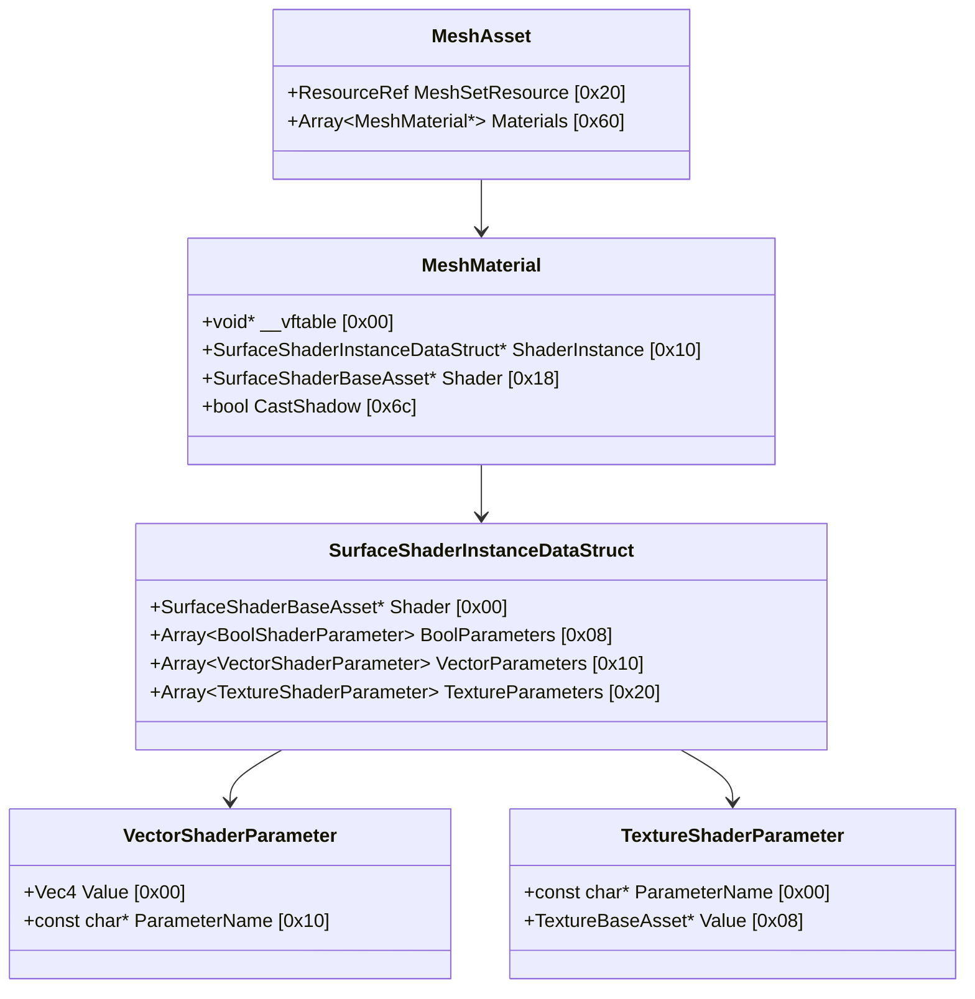
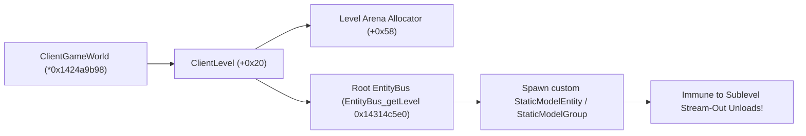

# Custom Maps, Meshes & Asset Spawning Pipeline

Reverse engineering research on Frostbite 3 asset discovery, resource compartments, dynamic partition injection, hardware-instanced static model groups, runtime object placement, and custom collision for Mirror's Edge Catalyst.

> [!NOTE]
> This document represents reverse-engineering research derived from Ghidra decompilation, reflected type definitions (`gridnode-reflected.json`), and binary disassembly of `MirrorsEdgeCatalyst_dump_SCY.exe` (Image Base `0x140000000`). All findings are to be verified in game during runtime execution.

---

## 1. Asset & Partition Architecture in Frostbite 3

Frostbite 3 divides all game data into two distinct layers:
1. **EBX Data Layer (Type-Reflected Objects)**:
   Structured data containers derived from `DataContainer` (e.g. `StaticModelEntityData`, `MeshAsset`, `ObjectBlueprint`). These are stored inside **Partitions** within **Resource Compartments**.
2. **Binary Resource Layer (RES / Chunks)**:
   Raw GPU vertex/index buffers, textures, shaders, and Havok collision blobs, identified by 64-bit integer Resource IDs (e.g. `MeshSetResource`, `HavokAsset.Resource`).



---

## 2. In-Memory Asset Discovery & Compartments

### 2.1 The Compartment Registry (`ResourceGroups`)
Frostbite manages up to `0xbbd` (3,005) resource compartments stored in the global table `ResourceGroups` at `0x14237deb8`:
- **Static Compartment (`ID = 0`)**:
  Loaded during game initialization (`getCompartment(0)` at `0x142abad00`). Holds core engine assets, global blueprints, and universal materials.
- **Dynamic Sublevel Compartments (`ID > 0`)**:
  Created dynamically when sublevels and streaming bundles load. Each active compartment pointer resides at `ResourceGroups[id] + 0x68`.

### 2.2 Name Resolution & DJB2-XOR Hash (`0x142aeb940`)
Partition lookups in `Partition_findByName` (`0x142aeb310`) query a hash map at `compartment + 0x158`:
- `compartment + 0xc0`: Compartment mutex (`FUN_142a9f970` lock, `FUN_142aa1840` unlock).
- `compartment + 0x158 + 0x08`: Bucket pointer array (`PartitionMapNode**`).
- `compartment + 0x158 + 0x10`: Bucket count (`uint32_t`).

The hashing function at `0x142aeb940` implements a case-insensitive lowercase **DJB2-XOR** hash:
```cpp
uint32_t djb2_xor_lowercase(const char* path) {
    uint32_t hash = 5381; // 0x1505
    for (const char* p = path; *p != '\0'; ++p) {
        char c = *p;
        if (c >= 'A' && c <= 'Z') c += 0x20; // tolower
        hash = (hash * 33) ^ (uint8_t)c;
    }
    return hash;
}
```
The bucket index is:
$$\text{bucket} = \text{hash} \pmod{\text{compartment->bucketCount}}$$

Each node in the bucket linked list (`PartitionMapNode`, size `0x18`) contains:
- `node + 0x00`: Resource path string pointer (`const char* path`).
- `node + 0x08`: Pointer to the loaded `Partition*`.
- `node + 0x10`: Pointer to the next node in the bucket chain (`PartitionMapNode* next`).

### 2.3 Partition Memory Layout
Confirmed via decompilation of `Partition_findByGuid` (`0x142aeb230`), `Partition_primaryInstance` (`0x142aec640`), and `FUN_142aec3f0`:
- `partition + 0x00`: `void* __vftable` (Partition vtable).
- `partition + 0x08`: `uint8_t partitionGuid[16]` (16-byte partition GUID).
- `partition + 0x18`: `const char* name` (Resource name string pointer).
- `partition + 0x20`: `DataContainer** instances` (Pointer to contiguous array of `DataContainer*`).
- `partition + 0x28`: `uint16_t instanceCount` (Number of instances stored).

Every reflected `DataContainer` has its 16-byte asset GUID placed at `(char*)container - 0x10` (the EBX instance header). When `Partition_findByGuid(partition + 8, guid)` executes, it compares the 16-byte target GUID against `*(instance - 0x10)` using a binary search/indexed scan over `instanceCount` elements.

### 2.4 Multi-Compartment Search Algorithm
Because custom assets packaged into Frosty `.fbmod` archives may be assigned to specific sublevel bundles (non-zero compartment IDs), a mod can locate any loaded mesh across the entire game by scanning all active compartments:
```cpp
void* findLoadedPartition(const char* path) {
    // 1. Check static compartment first (id 0)
    void* staticComp = getCompartment(0);
    if (staticComp) {
        void* part = Partition_findByName(staticComp, path);
        if (part) return part;
    }
    // 2. Iterate all dynamic sublevel compartments (1 .. 0xbbd)
    for (uint16_t id = 1; id < 0xbbd; ++id) {
        uintptr_t group = *(uintptr_t*)(0x14237deb8 + id * 8);
        if (!group) continue;
        void* comp = *(void**)(group + 0x68);
        if (!comp) continue;
        void* part = Partition_findByName(comp, path);
        if (part) return part;
    }
    return nullptr;
}
```

---

## 3. Dynamic Partition Injection Without Bundles

A major technical unknown was whether custom assets require packaging into offline `.fbmod` / `.sb` super-bundles, or if synthetic partitions can be injected directly into live memory.

Ghidra decompilation of `Partition_findByNameInStaticCompartment` (`0x142aeb310`) and `PartitionMap_find` (`0x142aeb940`) confirms the exact hash map structure at `compartment + 0x158`, enabling runtime partition injection:



### In-Memory Injection Steps:
1. **Allocate Synthetic Partition**:
   Allocate 48 bytes (`0x30`) on the heap for the `Partition`:
   - `+0x00`: Borrow vtable pointer from any valid partition (e.g. from static compartment).
   - `+0x08`: 16-byte custom GUID.
   - `+0x18`: Custom name string pointer (e.g. `"CustomMap/IndustrialBridge_Mesh"`).
   - `+0x20`: Pointer to an array of pointers `DataContainer*[]` containing custom `RigidMeshAsset*` or `ObjectBlueprint*`.
   - `+0x28`: Instance count `1`.
2. **Calculate Bucket Index**:
   Compute `idx = djb2_xor_lowercase(name) % *(uint32_t*)(compartment + 0x168)`.
3. **Allocate `PartitionMapNode` (24 bytes)**:
   - `node->path = name;`
   - `node->partition = syntheticPartition;`
   - `node->next = *(PartitionMapNode**)(compartment + 0x160 + idx * 8);`
4. **Insert into Bucket**:
   - Call `FUN_142a9f970(compartment + 0xc0)` to lock the compartment.
   - Set `*(PartitionMapNode**)(compartment + 0x160 + idx * 8) = node;`
   - Call `FUN_142aa1840(compartment + 0xc0)` to unlock.

Once linked into the bucket chain, any subsequent engine lookup (`Partition_findByName`, `resourceGroup_findOrCreateEntry`, `findLoadedPartition`) resolves the injected partition seamlessly.

---

## 4. Hardware-Instanced Multi-Mesh Groups (`StaticModelGroup`)

When spawning custom maps containing dozens or hundreds of structural pieces (road segments, railings, catwalks, pipes), spawning individual `StaticModelEntity` objects creates excessive CPU overhead in `EntityBus`, spatial hierarchy, and individual draw call submission.

Frostbite 3 solves this via `StaticModelGroupEntity`:
- Groups all instances of identical or related meshes into a single entity.
- Uses GPU hardware instancing for high-throughput, low-draw-call rendering.

### 4.1 Reflected Group Architecture
Confirmed in `gridnode-reflected.json`:



| Class / Struct | Vtable / Size | Realm | Description |
|---|---|---|---|
| `StaticModelGroupEntityData` | `0x141b73f40` (size `0xb0` / 176 bytes) | Shared | Reflected data container holding member definitions array at `+0x90`. |
| `StaticModelGroupMemberData` | No vtable (size `0x68` / 104 bytes) | ValueType | Holds `InstanceTransforms` array at `+0x08`, `MeshAsset*` at `+0x38`, `InstanceCount` at `+0x40`. |
| `ClientStaticModelGroupEntity` | `0x141afbe90` (size `0x108` / 264 bytes) | Client | Client entity managing GPU draw batches and culling registration. |
| `ServerStaticModelGroupEntity` | `0x141b5e3a0` (size `0xc0` / 192 bytes) | Server | Server entity managing network IDs and physical part health states. |

### 4.2 Group Member Placement (`0x14318fbc0`)
When `ClientStaticModelGroup_placeMember` (`0x14318fbc0`) runs:
1. It iterates through all `InstanceCount` copies in `memberData`.
2. For copy $i$, it multiplies `InstanceTransforms[i]` by the group entity's world `LinearTransform`:
   $$\mathbf{T}_{\text{world}} = \mathbf{T}_{\text{instance}[i]} \times \mathbf{T}_{\text{group}}$$
3. It calls `RenderObject_buildUpdate` and submits the transformed bounding box to `RenderWorld` (`GameWorlds[0] + 0x48`) via `RenderWorld_submitUpdate`.
4. It calls `StaticModelGroup_placementHash` (`0x143b722e0`) to compute a 16-byte quantized spatial hash combining the mesh asset pointer and centimeter-quantized transform. This placement hash enables Frostbite's instanced renderer to batch identical instances across the scene into single hardware-instanced draw calls.

---

## 5. Material & Shader Parameter Overrides

When placing custom meshes, authoring new HLSL shaders is rarely necessary. Existing Frostbite PBR architectural shaders (e.g. concrete, metal, glass, plastic) can be dynamically customized by modifying shader instance parameters at runtime:



### Parameter Array Formats:
1. **Vector Parameters (`+0x10`)**:
   - Stride: `0x20` (32 bytes).
   - `+0x00`: `Vec4 Value` (float $x, y, z, w$).
   - `+0x10`: `const char* ParameterName` (e.g. `"_Color"`, `"_EmissiveColor"`, `"_SmoothnessMultiplier"`, `"_Metallic"`).
2. **Texture Parameters (`+0x20`)**:
   - Stride: `0x10` (16 bytes).
   - `+0x00`: `const char* ParameterName` (e.g. `"_Diffuse"`, `"_Normal"`, `"_Mask"`).
   - `+0x08`: `TextureBaseAsset* Value` (Pointer to any loaded texture asset).

By cloning a template `MeshMaterial` (`0x70` bytes, vtable `0x141bbdae0`) and replacing parameter arrays, custom maps can restyle geometric props with custom colors, emissive accents, or textures without triggering shader re-compilation.

---

## 6. Binary Mesh Set Format & GPU Buffer Ingestion

At the lowest binary resource layer, every static mesh in Frostbite 3 is defined by a `MeshSetResource` (`RES` file), consumed at runtime by `MeshSet_deserializeFromRes` (`0x1435404c0`):

### 6.1 `MeshSetResource` Binary Memory Image
| Offset | Type | Field Name | Description |
|---|---|---|---|
| `+0x20 + i*8` | `uint64_t[]` | `LodPointers` | Pointers to `MeshLod` records (up to LOD count). |
| `+0x88` | `uint32_t` | `Flags` | Bit 0: Streamed flag (`0` = inline GPU geometry; `1` = streamed from chunk). |
| `+0x8c` | `uint16_t` | `LodCount` | Total number of LOD levels. |
| `+0x8e` | `uint16_t` | `SectionCount`| Total mesh draw sections across all LODs. |

### 6.2 `MeshLod` Record Layout
| Offset | Type | Field Name | Description |
|---|---|---|---|
| `+0x08` | `uint32_t` | `SectionCount` | Draw sections belonging to this LOD. |
| `+0x0c` | `void*` | `SectionArray` | Pointer to section records (stride `0x130` = 304 bytes). |
| `+0x50` | `uint32_t` | `LodFlags` | Bit `0x40` = 32-bit indices; Bit `0x20000000` = GPU buffers ready. |
| `+0x54` | `uint32_t` | `IndexFormat` | DXGI index format (typically `DXGI_FORMAT_R16_UINT`). |
| `+0x58` | `uint32_t` | `IndexCount` | Number of vertex indices. |
| `+0x5c` | `uint32_t` | `IndexBufferOffset` | Offset in bytes from vertex data start to index buffer. |
| `+0x60` | `uint32_t` | `SecondBufferCount` | Optional second stream attribute count (stride 8 bytes). |
| `+0x74` | `uint32_t` | `GeometryOffset` | Offset into inline buffer where vertex geometry begins. |
| `+0x9c` | `void*` | `GpuRecord` | Pointer to GPU buffer pointers block (`+0x08` VB, `+0x10` IB, `+0x38` extra stream). |

### 6.3 GPU Buffer Creation (`MeshLod_createGpuBuffers` at `0x14354fe00`)
The routine invokes `(*g_renderDevice)->createBuffer` (vtable slot 21 / `0xa8`) twice:
1. **Vertex Buffer**: Created using data at `geometryBase + lod->GeometryOffset`.
2. **Index Buffer**: Created using data at `geometryBase + lod->GeometryOffset + lod->IndexBufferOffset`.
Upon buffer allocation, the function sets bit `0x20000000` in `lod->LodFlags` (`+0x50`) to enable rendering passes.

---

## 7. Sublevel Streaming Anchoring & Root Level Bus

Entities spawned into dynamic sublevel buses are destroyed when that sublevel streams out during zone transitions (`ServerSubLevelEntity_onEvent` / `sublevel_unload`).

To ensure custom maps, custom props, and injected test geometry persist indefinitely regardless of player navigation across the city:



### Technical Mechanism:
1. **Root Level Discovery**:
   - Call `EntityBus_getLevel(bus)` (`0x14314c5e0`):
     ```cpp
     Level* EntityBus_getLevel(void* bus) {
         return *(Level**)(*(uintptr_t*)bus + 0x38);
     }
     ```
   - Alternatively, read `ClientLevel*` from `*(ClientGameWorld + 0x20)`.
2. **Level Lifetime Flag**:
   - `ClientEntity_spawnBlueprint` (`0x1431c4830`) verifies that `(*(uint8_t*)(level + 0x30) & 1) == 0`. As long as this bit is zero, the level is actively playing and valid for entity instantiation.
3. **Persistent Root Spawning**:
   - By creating a child bus under the root Level bus (via `fb_EntityBus_create` `0x143146e90` with `parentBus = rootBus`), the spawned custom map remains active until the entire mission or level is torn down.

---

## 8. Custom Collision Strategies for Custom Meshes

When placing custom geometry that differs from existing props, four distinct collision solutions are available:

| Strategy | Implementation | Pros | Cons |
|---|---|---|---|
| **1. Standalone Havok Box / Hull (API 34)** | Set `clonedData->PhysicsData = nullptr`. Simultaneously spawn native Havok bodies (`PhysicsEntityFactory_createBody` `0x143516450` via `DummyBarrierEntity` architecture). | Exact bounding box collision; fully independent; immune to reload crashes. | Limited to primitive shapes (box, sphere, capsule). |
| **2. Prop Borrowing (Phase 1)** | Point `clonedData->PhysicsData` to a geometrically similar prop's existing `PhysicsData`. | Zero extra code; immediate. | Collision extents do not match custom geometry. |
| **3. Static Compound Part Injection** | Append a new `hknpShapeInstance` (`0x80` bytes) to a level `GroupRigidBody` (`hknpStaticCompoundShape` at `+0x58`) and trigger broadphase dirty flag (`0x400` in `body + 0x58`). | Arbitrary mesh collision; participates in broadphase island solving. | Requires managing Havok static tree domains and instance indices. |
| **4. Frosty Precompiled Havok Asset** | Package an authored `HavokAsset` (`.bin` Havok resource) in the Frosty bundle alongside the duplicated mesh, pointing `PhysicsEntityData->Asset` to it. | Perfect triangle mesh collision. | Requires authoring Havok collision resources externally during mod packaging. |

---

## 9. Layout Editor & Persistence Improvements (Frosty-Unity Pipeline Insights)

Analysis of the Frosty-Unity Pipeline (FUP) reveals two critical improvements for GridNode's layout system:

1. **Robust Entity Keying**:
   - Previous GridNode layouts matched entities by `(kind, position)`. This is fragile: two identical props near each other collide, and an object moved by a prior edit fails to match on next load.
   - **Solution**: Key edits by `(partitionGuid, dataBusPeerFlags)` or `IndexInBlueprint`. Every entity data has `DataBusPeer.Flags` at `+0x10`, which remains stable across game executions and level loads.
2. **Non-Destructive Object Removal**:
   - Deleting entities directly crashes the engine because internal component collections maintain dense indices.
   - **Solution**: "Hide at $y = -15,000$" (`kParkDepth`). Translating the object $15,000 \text{ m}$ below the level removes both visual drawing (frustum and occlusion culling) and collision (broadphase bounds exclusion) without freeing memory or disrupting indices.

---

## 10. Summary of Technical Facts & Annotations

| Item | Address / Offset | Confirmed Behavior |
|---|---|---|
| `ResourceGroups` Table | `0x14237deb8` | Global array of pointers to active resource groups (max `0xbbd` / 3,005 entries). |
| `getCompartment` | `0x142abad00` | Extracts `group + 0x68` (compartment pointer). ID 0 is static compartment. |
| `Partition_findByName` | `0x142aeb310` | Finds `Partition*` in `compartment + 0x158` using case-insensitive DJB2-XOR hash. |
| `PartitionMap_find` | `0x142aeb940` | Lowercase DJB2-XOR bucket traversal (`hash = (hash * 33) ^ tolower(c)`). |
| `Partition_findByGuid` | `0x142aeb230` | Binary search / scan over `Partition->instances` matching 16-byte asset GUID. |
| `Partition_primaryInstance`| `0x142aec640` | Extracts primary asset instance `**(partition + 0x20)`. |
| `Partition` Structure | `0x30` bytes | `+0x08 Guid`, `+0x18 name`, `+0x20 instances`, `+0x28 instanceCount`. |
| `PartitionMapNode` | `0x18` bytes | `+0x00 path`, `+0x08 partition`, `+0x10 next`. |
| `StaticModelGroupEntityData` | `0x141b73f40` (size `0xb0`) | Holds `MemberDatas` array at `+0x90`. |
| `StaticModelGroupMemberData` | Size `0x68` bytes | `InstanceTransforms` at `+0x08`, `MeshAsset` at `+0x38`, `InstanceCount` at `+0x40`. |
| `ClientStaticModelGroupEntity` | `0x141afbe90` (size `0x108`) | Hardware-instanced client entity (vtable `0x141afbe90`). |
| `ServerStaticModelGroupEntity` | `0x141b5e3a0` (size `0xc0`) | Replicated server entity (vtable `0x141b5e3a0`). |
| `ClientStaticModelGroup_placeMember` | `0x14318fbc0` | Multiplies member transforms by group transform and submits to `RenderWorld`. |
| `StaticModelGroup_placementHash` | `0x143b722e0` | Quantizes transform into 16-byte placement hash for GPU instancing batches. |
| `MeshSet_deserializeFromRes` | `0x1435404c0` | Reads binary mesh headers, LOD records, and section declarations. |
| `MeshLod_createGpuBuffers` | `0x14354fe00` | Creates D3D11 vertex and index buffers via render device slot 21. |
| `EntityBus_getLevel` | `0x14314c5e0` | Extracts `*(Level**)(*(uintptr_t*)bus + 0x38)`. |
| `ClientEntity_spawnIntoBus` | `0x1431c44b0` | Spawns entity data into specified entity bus, creating child bus if requested. |
