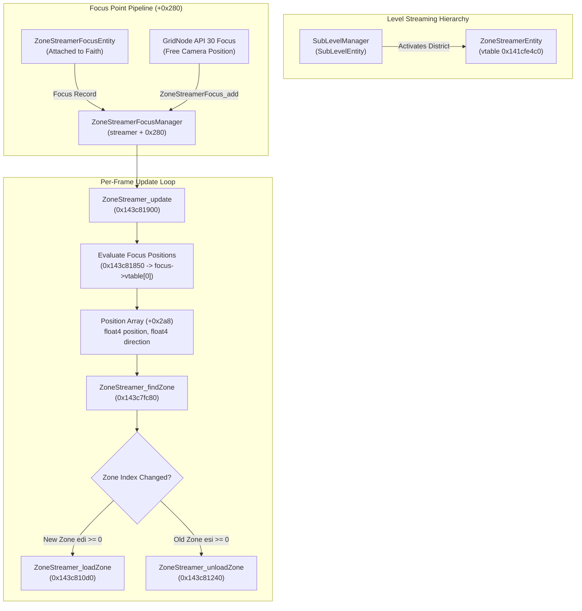

# Free Camera Streaming & Zone Streamer Focus Points Reverse Engineering

> [!NOTE]
> **Status**: Reverse engineered from binary dump (`MirrorsEdgeCatalyst_dump_SCY.exe`, Image Base `0x140000000`) and validated against `GridNode` layout engine (`sdk/src/layouts.cpp`). Database annotations added to [`db/annotations/levels.yaml`](file:///D:/Dev/GridNode/db/annotations/levels.yaml).
> **Confirmation Status**: Pure research for now; to be confirmed in game during live gameplay testing.

---

## 1. Executive Summary & Core Verdict

This document answers the core research questions posed in **Option 6** of [`docs/research/open-research.md`](file:///D:/Dev/GridNode/docs/research/open-research.md):
> *"Does the game already stream the world around the free camera? `zone-streaming.md` and API 30 (streaming focus points) were written without an answer: the trainer's test showed nothing either way. Instrument the zone streamer's focus list while the camera flies far away, and decide whether the API is needed."*

### Key Conclusions:
1. **Does the game already stream the world around the free camera?**
   **NO, absolutely not.**
   - A complete binary scan reveals **only two callers** of `ZoneStreamerFocus_add` (`0x143c7e7c0`) in the entire executable: `ZoneStreamerFocusEntity_onEvent` (`0x143c7f47a`) and `ZoneStreamerFocusEntity_init` (`0x143c80447`).
   - In the retail game, `ZoneStreamerFocusEntity` is placed in level blueprints and **strictly parented to Faith's player character** (`ClientPlayer` / `CharacterEntity`).
   - The entire camera subsystem (`ClientCameraViewManager`, `CameraObject`, `FPSCamera`) has **zero integration** with `ZoneStreamer`. When Freecam or cinematic camera tools move the camera away from Faith, the camera view matrices update for rendering, but the game engine continues streaming zones solely based on Faith's physical location.
   - As a consequence, flying far away from Faith causes distant district geometry, building interiors, dynamic props, collision, and textures to remain unstreamed (rendering only low-LOD distant backdrop impostors or empty voids).
2. **Is API 30 (`streamingFocusAdd`, `streamingFocusMove`, `streamingFocusRemove`) needed?**
   **YES, IT IS CRUCIAL.**
   - Without API 30, freecam flight, cinematic camera sweeps, replay cameras, and remote prop placement (Layout Editor) cannot function properly beyond Faith's immediate streaming radius.
   - Registering a dynamic focus point via API 30 injects the free camera's coordinates into `ZoneStreamerEntity`'s internal focus manager (`streamer + 0x280`), forcing the engine to stream in full district details wherever the camera travels.
3. **Why did the trainer's test show "nothing either way"?**
   - **Local Streaming Buffer**: Around Faith, the active streaming radius is already 300--400 meters wide. Moving the camera nearby exhibits no visible change because the zones are already loaded by Faith's own focus point.
   - **District Grid Disconnection**: Each district sublevel (e.g. `CentralCityBuildings_ZS`) possesses its own dedicated `ZoneStreamerEntity` covering a finite coordinate bounding box. If the camera flies outside that district's bounding grid, `ZoneStreamer_findZone` (`0x143c7fc80`) returns `-1` (no zone found), and the streamer loads nothing.
   - **Sublevel Inactivity**: If the camera enters a district whose sublevel has not been activated at the `SubLevelManager` level, the corresponding `ZoneStreamerEntity` does not yet exist in the world.

---

## 2. Zone Streaming Subsystem Architecture

Frostbite manages open-world streaming through a two-tier hierarchy:
1. **Sublevel Streaming (`SubLevelManager`)**: Streams overarching district bundles (e.g. `Levels/SP/SP_MainCity/CentralCityBuildings_ZS`).
2. **Zone Streaming (`ZoneStreamerEntity`)**: Operates inside an active district sublevel to dynamically stream in/out granular spatial *zones* based on active **focus points**.



### 2.1 `ZoneStreamerEntity` Memory Layout
- Vtable: **`0x141cfe4c0`**
- Size: **`0x710`** bytes
- Key member offsets:
  - `+0x268`: `ClassLink` (`void*` - node in `ClassInfo` per-world entity linked list; `node - 0x268 = entity`).
  - `+0x280`: `FocusManager` header (`ZoneStreamerFocusManager`).
  - `+0x288`: `Records` pointer (`FocusRecord*` array).
  - `+0x2a8`: `FocusPositions` array pointer (evaluated `float4` positions and `float4` directions; stride `0x20` per focus).
  - `+0x2c8`: `FocusCount` (`uint32_t` - active focus point count).
  - `+0x2d8`: `GridData` (`void*` - district spatial grid partition and zone AABB boundary tree).

### 2.2 Focus Manager Record Layout (`0x18` bytes)
Each registered focus point occupies a 24-byte record in `streamer + 0x288`:

| Offset | Type | Member | Description |
|---|---|---|---|
| `+0x00` | `uint64_t` | `key` | User / entity identifier key (typically 0) |
| `+0x08` | `void*` | `focusInterface` | Pointer to object with focus interface vtable (`0x141cfe528`) |
| `+0x10` | `int32_t` | `currentZoneIndex` | Currently loaded zone index for this focus point (`-1` = none) |
| `+0x14` | `uint32_t` | `flags` | Bitfield flags; **Bit 0 (`0x01`) = removed flag** |

---

## 3. Focus Evaluation & Zone Streaming Pipeline

### 3.1 Position Evaluation (`0x143c81850`)
Every frame, `ZoneStreamer_update` (`0x143c81900`) invokes `0x143c81850`:
```cpp
// Decompiled logic of 0x143c81850:
void evaluateFocusPositions(FocusManager* mgr) {
    uint32_t count = mgr->count; // +0x48 (streamer + 0x2c8)
    FocusRecord* records = mgr->records; // +0x08 (streamer + 0x288)
    float* outArray = mgr->positions;   // +0x28 (streamer + 0x2a8)

    for (uint32_t i = 0; i < count; ++i) {
        FocusRecord& rec = records[i];
        float* out = outArray + (i * 8); // 0x20 bytes stride: 4 floats pos, 4 floats dir

        if (rec.flags & 1) { // Removed flag set
            // Write default dummy position
            out[0] = 0.0f; out[1] = -10000.0f; out[2] = 0.0f; out[3] = 1.0f;
            out[4] = 0.0f; out[5] = 0.0f; out[6] = 1.0f; out[7] = 0.0f;
            continue;
        }

        // Virtual call: focusInterface->vtable[0](focusInterface, key, out)
        using GetFocusFn = void (*)(void* focus, uint64_t key, float* out);
        void** vtable = *reinterpret_cast<void***>(rec.focusInterface);
        reinterpret_cast<GetFocusFn>(vtable[0])(rec.focusInterface, rec.key, out);
    }
}
```

### 3.2 Spatial Containment & Zone Lookup: `ZoneStreamer_findZone` (`0x143c7fc80`)
After positions are evaluated, `0x143c82060` iterates each position $(x, y, z)$ and calls `ZoneStreamer_findZone` (`0x143c7fc80`):
- Reads bounding AABBs from `gridData` (`streamer + 0x2d8`).
- Performs SIMD comparison (`cmpltps`, `movmskps`) on $(x, z)$ planar extents and vertical height intervals.
- **Return Value**:
  - `zoneIndex >= 0`: Index of the matching zone containing the coordinates.
  - `-1` (`0xffffffff`): Coordinates lie outside the district grid partition!

### 3.3 Dynamic Load and Unload Dispatch
If the newly evaluated zone `edi` differs from the record's prior zone `esi` (`record + 0x10`):
```cpp
if (newZone != oldZone) {
    // Notify streamer of transition
    ZoneStreamer_transition(streamer, oldZone, newZone); // 0x143c7ed80

    if (newZone >= 0) {
        // Stream IN the new zone
        ZoneStreamer_loadZone(streamer, newZone, record, 1); // 0x143c810d0
    }
    if (oldZone >= 0) {
        // Stream OUT the vacated zone
        ZoneStreamer_unloadZone(streamer, oldZone, record, 1); // 0x143c81240
    }

    record->currentZoneIndex = newZone; // Update cached index (+0x10)
}
```

---

## 4. Vanilla vs. API 30 Streaming Focus Comparison

| Feature | Vanilla Game Engine | GridNode API 30 (`streamingFocus*`) |
|---|---|---|
| **Focus Object** | `ZoneStreamerFocusEntity` (vtable `0x141cfe460`) | Static `ZoneFocus` struct (`g_focus[8]`) |
| **Tracked Target** | Faith (`ClientPlayer` / `CharacterEntity`) only | Free Camera / Remote Library Placement |
| **Interface Vtable** | `0x141cfe528` (`slot 0` = `0x143c7f9a0`) | Dedicated vtable (`slot 0` = `zoneFocusGet`) |
| **Registration Call** | `ZoneStreamerFocus_add` (`0x143c7e7c0`) | `ZoneStreamerFocus_add` (`0x143c7e7c0`) |
| **Removal Mechanism** | `ZoneStreamerFocus_remove` (`0x143c81390`) *(Buggy!)* | Directly sets Bit 0 (`rec + 0x14 |= 1`) *(Safe!)* |
| **Camera Following** | **None** (world unloads around camera) | **Real-time** (~4 Hz / 250 ms camera sync) |

> [!CAUTION]
> **Vanilla Out-of-Bounds Write Bug in `ZoneStreamerFocus_remove` (`0x143c81390`)**:
> The game's native `ZoneStreamerFocus_remove` iterates records to find a matching pointer. If no match is found, it uses the loop termination index (`0xffffffff` / count) and writes `flags |= 1` out of bounds into heap memory.
> GridNode correctly avoids this crash by locating the matching record first and directly marking bit 0 on the confirmed record pointer.

---

## 5. Why Freecam Streaming Showed Inconclusive Results & How to Fix It

### 5.1 Root Causes of Inconclusive Trainer Tests
1. **Streaming Radius Masking**: Within 300--400 meters of Faith, the city zones are already resident in memory due to Faith's own focus point. Flying nearby reveals no streaming activity because the zones are already active.
2. **Multi-Streamer Spatial Partitioning**: Glass / Anchor / Downtown / The View are governed by **distinct sublevels**, each with its own `ZoneStreamerEntity`. A focus point registered with the Downtown streamer will return `-1` if the camera flies into Anchor coordinates.
3. **Sublevel Inactivation**: If the camera crosses district boundaries into a sublevel that is completely unloaded at the `SubLevelManager` level, zone streaming cannot engage because the district's `ZoneStreamerEntity` does not exist in `GameWorld`.

### 5.2 The Full Solution for Freecam Streaming
To achieve seamless, boundless freecam flight across the entire world:
1. **Camera Position Sync (Low-Level)**:
   Register the free camera via `streamingFocusAdd` / `streamingFocusMove`. Ensure the point is registered across **all live zone streamers** returned by `zoneStreamers()` in both client and server worlds.
2. **Sublevel Proximity Streaming (High-Level)**:
   When the free camera approaches an unloaded district boundary, inject a `StreamIn` event (`0xd27bc17e`) into the corresponding `ServerSubLevelEntity` (`0x14335efb0`) to instantiate that district's `ZoneStreamerEntity`.

---

## 6. Open Research & Future Directions

> [!IMPORTANT]
> The following areas remain open for future live in-game testing:
> 1. **Sublevel Pre-Streaming Integration**: Trace `SubLevelManager_drainPendingSubWorlds` (`0x1432eaba0`) to develop an automatic sublevel streamer that activates district sublevels based on camera distance before zone streaming engages.
> 2. **Zone Search Tolerance Tuning**: Reverse engineer `0x143c7fb40` to evaluate whether artificially expanding the zone search radius parameter allows earlier pre-loading of upcoming districts during high-speed camera movement.
