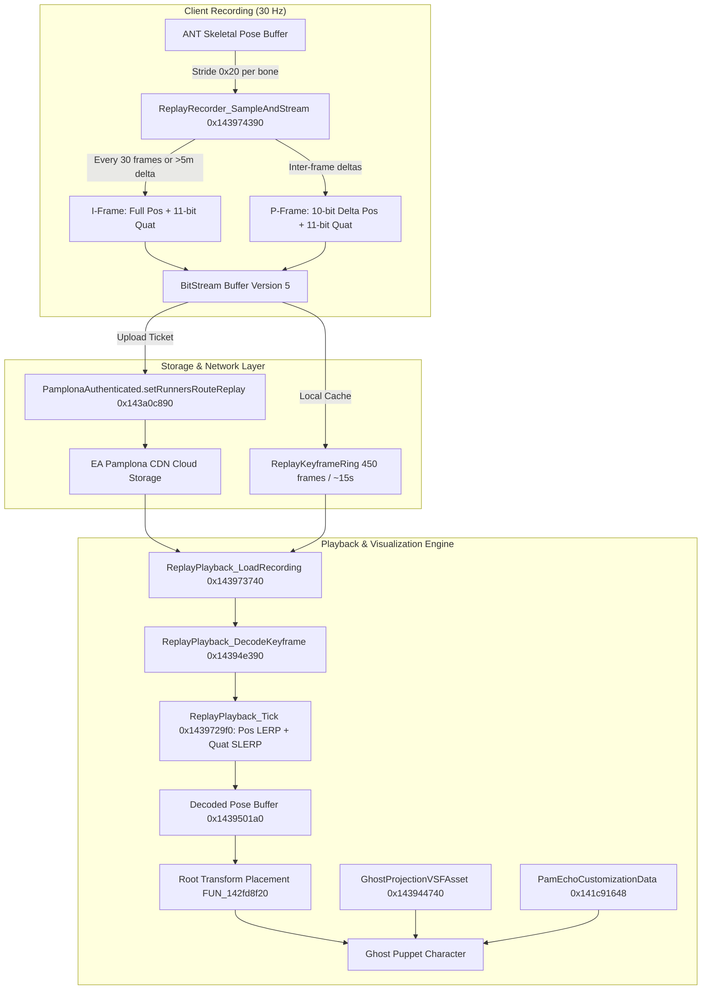

# Ghost & Echo Runner Replay and Trajectory Pipeline

This document details the reverse engineering of Mirror's Edge Catalyst's player replay and echo pipeline. It covers recording, bitstream compression, skeletal pose playback, holographic visual shaders, echo customizations, and online Pamplona/Gateway network endpoints.

Related annotations live in [`db/annotations/replay.yaml`](file:///D:/Dev/GridNode/db/annotations/replay.yaml) and [`db/annotations/messages.yaml`](file:///D:/Dev/GridNode/db/annotations/messages.yaml).

---

## 1. Executive Summary & Architecture Overview

In Mirror's Edge Catalyst, player runs in Dashes, Time Trials, and Billboard hacks can be recorded, serialized into compressed bitstreams, and streamed to backend servers or rendered in real time as translucent holographic "echo" runners.

The architecture comprises five interconnected tiers:
1. **Recording & Sampling Engine**: Driven by `PamClientReplayRecordingComponent` (`0x141c46d78`, updater `0x14394dac0`) at **30 Hz** ($33.333\text{ ms}$). Samples bone transforms directly from ANT's live skeletal pose buffer (`*(updater + 0x28)`).
2. **Bitstream Compression Engine (Format Version 5)**: Implemented in `ReplaySetup_WriteHeader` (`0x1439516b0`) and `ReplayKeyframe_Write` (`0x143951450`). Implements an adaptive **I-Frame / P-Frame** schema with **10-bit quantized delta position** ($\pm 5.0\text{ m}$) and **11-bit quantized rotation quaternions**, protected by an integrated 32-bit DJB2 skeleton layout checksum.
3. **Playback & Skeletal Reconstruction Engine**: Driven by `PamClientReplayPlayerComponent` (vtable `0x141c48a28`, ctor `0x143944860`, update `0x1439501a0`) and `ReplayPlayback_Tick` (`0x1439729f0`). Performs real-time linear interpolation (LERP) of translations and spherical linear interpolation (SLERP) of quaternions between decoded ring buffer frames.
4. **Visual Shader & Echo Customization Tier**: Renders the translucent holographic runner silhouette using `Shaders/SpecialUseCase/GhostProjectionVSFAsset` (`0x141c48540`, ctor `0x143944740`), controlled by `PamUseRunnersGhostShader` (`0x141c80098`) and `PamGhostInRvColorBurnPass` (`0x141c800c8`). Color palettes and echo trails are driven by `PamEchoCustomizationData` (`0x141c91648`) and `PamClientEchoCustomizationManagerEntity` (vtable `0x141c73c18`).
5. **Network Replay Serialization & Pamplona Endpoints**: Manages upload and download of binary trajectory replays and ghost metadata via `PamplonaAuthenticated.setRunnersRouteReplay` (`0x143a0c890`), `Pamplona.getPlayerGhosts` (`0x1439f98d0`), `PamSocialPlayNamedChallengeUploadReplayMessage` (`0x955f5cbd`), and `PamGatewayBackendGetPlayerGhostsRequestMessage` (`0x1221d60e`).



---

## 2. The 30 Hz Dual Ring-Buffer Pipeline

### 2.1 The Update Clock & Component System
The replay recorder runs inside `PamClientReplayRecordingComponent_updateAll` (`0x14394dac0`), registered on the client update pass via component manager vtable `0x141c48ca0` (`FUN_143945ff0`).

The recording tick clock runs at **30 Hz**:
$$\Delta t_{\text{tick}} = \frac{1}{30.0} \approx 0.033333335\text{ seconds}$$
Each tick checks whether the animatable entity has valid transforms and whether recording is enabled (`*(char*)(a3 + 0x38) != 0`).

### 2.2 Keyframe Ring Buffer (`ReplayRecorder`)
The internal state of `ReplayRecorder` (`0xf0` bytes) is allocated via `ReplayRecorder_InitSetupAndRing` (`0x14396f140`):
- `+0x68`: `stride` ($0x10 + \text{bones} \times 0x20$ bytes per frame).
- `+0x70`: `capacity` (initialized to `0x1c2` = 450 keyframes $\approx 15.0$ seconds of continuous recording).
- `+0x78`: `base` (pointer to aligned buffer allocated from `ReplayRecorder.arena`).
- `+0x88`: `head` (newest keyframe index, incremented modulo capacity).
- `+0x8c`: `tail` (oldest keyframe index once ring buffer wraps).
- `+0x90`: `notWrapped` (boolean flag: 1 during the initial 15 seconds, 0 after head wraps past tail).
- `+0x9c`: `time` (accumulated simulation seconds).
- `+0xd8`: `boneCount` (number of tracked skeleton bones, typically 22–32).
- `+0xe8`: `boneIndices` (`uint32_t*` array mapping each recorded track to ANT skeleton bone IDs).

### 2.3 Pose Sampling (`ReplayRecorder_SampleAndStream` `0x143974390`)
During each sample, bone transforms are read from the ANT pose buffer `*(longlong*)(a3 + 0x28)`. Each bone entry is exactly **32 bytes** (`0x20`):
- Offset `+0x00`: Translation vector $(X, Y, Z, W)$ as 4 single-precision floats (`f32[4]`).
- Offset `+0x10`: Orientation quaternion $(Q_x, Q_y, Q_z, Q_w)$ as 4 single-precision floats (`f32[4]`).

### 2.4 Low-Frequency HUD / Map Trajectory Stream
In addition to full skeletal keyframes, `ReplayRecorder_SampleAndStream` downsamples the runner's root position every **3 frames** ($10\text{ Hz}$):
```c
*(uint*)&recorder->field_0x40 = (*(int*)&recorder->field_0x40 - 2) >> 0x1f & (*(int*)&recorder->field_0x40 + 1);
```
When `field_0x40 == 0`, `FUN_14394b5d0` extracts world root coordinates into `local_48`, sets `time = currentTime - startTime`, and passes it to `FUN_143951840`. This creates the lightweight 3D spline trail used by the in-game 3D World Map and Billboard leaderboards.

---

## 3. Binary Bitstream Format Specification (Version 5)

Replay files and network payloads use a compact proprietary bitstream (`fb::BitStreamWriter` / `fb::BitStreamReader`).

### 3.1 Stream Header Format
Written by `ReplaySetup_WriteHeader` (`0x1439516b0`) and verified by `ReplayPlayback_ReadRecordingHeader` (`0x14394e560`):

| Bit Offset / Field | Bit Width | Data Type | Description |
| :--- | :--- | :--- | :--- |
| `0x00` | 32 bits | `uint32_t` | **Format Version**: Must be `5` (`0x00000005`). Any other value rejects stream loading immediately. |
| `0x20` | 32 bits | `uint32_t` | **Skeleton Layout DJB2 Checksum**: Verifies bone hierarchy, translation flags, and quantization precision. |
| `0x40` | 32 bits | `uint32_t` | **Bone Count ($N$)**: Total skeleton bones stored in this recording. |
| `0x60` | $N \times 32$ bits | `uint32_t[N]` | **Bone IDs Array**: ANT bone identifier hash for each recorded track. |
| Variable | $N \times 32$ bits | `uint32_t[N]` | **Parent Bone Indices Array**: Parent hierarchy index for each track. |
| Variable | 8 bits | `uint8_t` | **Animated Position Tracks Count ($M$)**: Number of bones with positional translation animated. |
| Variable | $M \times 8$ bits | `uint8_t[M]` | **Animated Bone Indices**: List of bone index numbers that emit position updates. |

### 3.2 The Skeleton Layout DJB2 Checksum
The checksum calculation in `ReplaySetup_WriteHeader` guarantees binary compatibility:
```cpp
uint32_t computeSkeletonChecksum(const uint32_t* boneIds, const uint8_t* posAnimatedFlags, uint32_t numBones) {
    uint32_t hash = 0x1505; // 5381 (standard DJB2 seed)
    for (uint32_t i = 0; i < numBones; ++i) {
        uint8_t boneLowByte = (uint8_t)(boneIds[i]);
        uint32_t hasPos = (posAnimatedFlags[i] != 0) ? 1 : 0;
        hash = (hash * 33 ^ (uint32_t)boneLowByte) * 33 ^ (hasPos + 1);
    }
    // Embed quantization bit lengths: 10 bits pos delta, 11 bits quat
    hash = (hash * 33 ^ 10) * 33 ^ 11;
    return hash;
}
```
If a mod attempts to play a replay with an altered bone count or differing quantization precision, the checksum verification in `0x14394e560` fails and aborts playback.

### 3.3 Keyframe Payload Encoding (`ReplayKeyframe_Write` `0x143951450`)
Every frame begins with:
1. **Timestamp**: Relative simulation seconds written via `FUN_142aa4eb0` (variable-length float bit encoding).
2. **Frame Header Flags** (2 bits):
   - `bit 0`: Frame Type ($1 = \textbf{I-Frame}, 0 = \textbf{P-Frame}$).
   - `bit 1`: Reserved / streaming flush flag.

#### A. I-Frame (Intra Keyframe / Full Frame)
Emitted under two conditions:
- The first frame of a stream (`param_3 == 0`).
- Every 30 frames ($1.0\text{ second}$) via `(*param_4 >= 30)`.
- When spatial delta exceeds $5.0\text{ m}$ in any single frame (e.g. teleport, respawn, or zipline attach).

Payload:
- For each position-animated bone: 3 uncompressed 32-bit single-precision floats $(X, Y, Z)$ written by `FUN_142aa6920` (96 bits).
- For each tracked bone: 11-bit quantized quaternion written by `thunk_FUN_142a9e4f0(stream, quat, 11)`.
  - Quaternion quantization uses the smallest-three representation: 2 bits indicate the largest component index, 1 bit indicates sign, and $3 \times 11 = 33\text{ bits}$ store the remaining three components scaled in $[-1.0, 1.0]$. Total $= 36\text{ bits}$ per bone rotation.

#### B. P-Frame (Inter / Delta Frame)
Emitted during continuous motion when delta $\le 5.0\text{ m}$:
- For each position-animated bone:
  - $\Delta \vec{P} = \vec{P}_t - \vec{P}_{t-1}$.
  - Tiny deltas with $|\Delta| < 10^{-6}$ are clamped to 0.0.
  - If any axis exceeds $5.0\text{ m}$, the bitstream writer rewinds to the frame start marker (`FUN_142aa39f0`), sets `bit 0 = 1`, and forces an immediate I-Frame.
  - Otherwise, $\Delta \vec{P}$ is encoded with **10-bit fixed-point quantization** clamped in $[-5.0, +5.0]\text{ m}$ (`thunk_FUN_142a9e330(stream, delta, 10, 5.0f)`). Step size $\approx 5.0 / 512 \approx 9.76\text{ mm}$ precision.
- For each tracked bone: 11-bit quantized quaternion (`thunk_FUN_142a9e4f0`).

---

## 4. Playback Architecture & Character Placement

### 4.1 Component Internals (`PamClientReplayPlayerComponent`)
The player component (size `0x310` bytes, vtable `0x141c48a28`) manages the decoded animation state:
- `+0x38`: Embedded `ReplayPlayback` stream context (vtable `0x141c48c28`).
- `+0x40`: Playback state (`1 = playing`, `0 = stopped`).
- `+0x180`: `receivedPose` (`ReplayBone*` pointer to decoded bone transforms).
- `+0x1c8`: Pointer to target `ClientCharacterEntity` puppet.
- `+0x1d8`: `interpolatedPose` (`ReplayBone*` pointer to blended active pose).
- `+0x200`: `expectedBones` (bone count from header).
- `+0x2e0`: `playbackSpeed` (float multiplier, default `1.0f`).
- `+0x2e4`: `poseValid` (`uint8_t` flag).
- `+0x2e5`: `hasPose` (`uint8_t` flag).
- `+0x2e6`: `skipRoot` (`uint8_t` flag; default `0`).
- `+0x2f8`: Handle to property output (`TI_Float32`, `0xb056cec3`), updated each frame with normalized progress $[0.0, 1.0]$:
  $$\text{progress} = \frac{\text{currentFrameIndex}}{\text{totalFrames}}$$

### 4.2 Interpolation Loop (`ReplayPlayback_Tick` `0x1439729f0`)
`ReplayPlayback_Tick` decodes incoming keyframes on the fly and maintains two adjacent keyframe samples $(F_0, F_1)$ with timestamps $(t_0, t_1)$.
For simulation time $t$, normalized blending weight $\alpha$ is:
$$\alpha = \text{clamp}\left(\frac{t - t_0}{t_1 - t_0}, 0.0, 1.0\right)$$
- **Translation**: Linearly interpolated:
  $$\vec{P}(t) = (1 - \alpha)\vec{P}_0 + \alpha\vec{P}_1$$
- **Rotation**: Spherically linearly interpolated (SLERP):
  $$\vec{Q}(t) = \text{slerp}(\vec{Q}_0, \vec{Q}_1, \alpha) = \frac{\sin((1 - \alpha)\theta)}{\sin\theta}\vec{Q}_0 + \frac{\sin(\alpha\theta)}{\sin\theta}\vec{Q}_1$$
  where $\cos\theta = \vec{Q}_0 \cdot \vec{Q}_1$. If $\cos\theta < 0$, $\vec{Q}_1$ is negated to take the shortest arc. If $1 - |\cos\theta| \le 10^{-6}$, it falls back to linear normalization.

### 4.3 World Transform & Root Placement (`PamClientReplayPlayerComponent_update` `0x1439501a0`)
When `skipRoot == 0`, `0x1439501a0` reconstructs world character coordinates:
- **Bone 0** is the character model root.
- **Bone 1** is `AITrajectory` (the world trajectory reference).
The final world position $\vec{P}_{\text{world}}$ and orientation quaternion $\vec{Q}_{\text{world}}$ are computed as:
$$\vec{P}_{\text{world}} = \text{bone}_0.\vec{t} + \text{bone}_0.t_w \times \text{rotate}(\text{bone}_0.\vec{q}, \text{bone}_1.\vec{t})$$
$$\vec{Q}_{\text{world}} = \text{bone}_0.\vec{q} \times \text{bone}_1.\vec{q}$$
The resulting transform matrix is passed directly to the character entity's spatial transform update function:
```c
FUN_142fd8f20(*(longlong*)(*(longlong*)(self + 0x1c8) + 0x158), &matrix, 0);
```

> [!NOTE]
> **The Height Desync / Drift Phenomemon in Replays**:
> Because Bone 1 (`AITrajectory`) stores world-space positions while Bone 0 can carry fractional root pitch/yaw rotations, any uncompensated tilt in Bone 0 multiplies across the world position vector: $\Delta \vec{P} = \vec{\theta} \times |\vec{P}_{\text{world}}|$. This causes runner ghosts to drift in height or clip through rooftops over long runs. MECMP compensates by computing Bone 1 translation as:
> $$\text{bone}_1.\vec{t} = \frac{\text{rotate}(\text{conj}(\text{bone}_0.\vec{q}), \vec{P}_{\text{target}} - \text{bone}_0.\vec{t})}{\text{bone}_0.t_w}$$

---

## 5. Visual Holographic Shaders & Runner Echo Customizations

### 5.1 Holographic Shader Asset (`GhostProjectionVSFAsset`)
Runner echo visuals do not use standard Frostbite PBR surface materials (`DiceSurfaceShader`). Instead, they are rendered via a specialized forward shader:
- Asset Path: `"Shaders/SpecialUseCase/GhostProjectionVSFAsset"` (`0x141c48540`).
- Material Factory: `FUN_143944740` (destructor `0x143945a90`).
- Render Passes:
  - `PamUseRunnersGhostShader` (`0x141c80098`): Enables edge fresnel glowing and scanline transparency.
  - `PamGhostInRvColorBurnPass` (`0x141c800c8`): Injects the runner ghost into the Runner's Vision post-processing buffer using a color burn blend mode, allowing the ghost to be visible through walls and occluding city geometry.

### 5.2 Echo Customization Architecture
Player echo appearance (tint color, holographic distortion, and particle trails) is governed by:
- `PamClientEchoCustomizationManagerEntity` (vtable `0x141c73c18`, registered at `0x143a46b60`).
- Customization Record `PamEchoCustomizationData` (`0x141c91648`, size `0x28` / 40 bytes):
  - `+0x00`: `NameSid` (Localization SID string for the echo name).
  - `+0x08`: `DescriptionSid` (Localization SID string).
  - `+0x10`: `TextureId` (Icon texture identifier string).
  - `+0x18`: `CustomizationData` (Asset pointer configuring shader material parameters).
  - `+0x20`: `CustomizationHash` (`uint32_t` unique variation hash).

### 5.3 Echo Customization Notification Message
When a player changes their active echo skin in the UI, the engine fires `PamSocialPlayEchoCustomizationChangedMessage` (`0x85ebbf13` under Social Play category `0x54776fc6`, size `0x38` / 56 bytes).

---

## 6. Network Replay Messaging & Backend Pamplona Protocol

### 6.1 Replay Upload Protocol
Uploading a recorded trajectory to EA servers uses a 2-step handshake:
1. **Upload Ticket Request**:
   Game invokes `PamplonaAuthenticated.setRunnersRouteReplay` (`0x143a0c890`):
   ```json
   {
     "challengeId": "uuid-string",
     "runId": 123456,
     "uploadTicket": "token-string"
   }
   ```
2. **Replay Payload Upload**:
   Fires `PamSocialPlayNamedChallengeUploadReplayMessage` (`0x955f5cbd`, category `0x54776fc6`, size `0x50` bytes), transmitting the raw Version 5 bitstream to the negotiated Pamplona S3/CDN storage URL.

### 6.2 Replay Download Protocol
1. Client requests replay URL: `PamGatewayBackendGetRunnersRouteReplayUrlRequestMessage` (`0x333b9deb`, category `0x3010e025`).
2. Server responds: `PamGatewayBackendGetRunnersRouteReplayUrlResponseMessage` (`0xe9f41379`).
3. Binary data is retrieved by `PamServerProjectionSpawnerEntity` (`0x141c7e920`) via download listener `0x143a8a910` and loaded into the ghost puppet via `PamServerProjectionSpawnerEntity_loadReplayIntoGhost` (`0x143a8e240`).

### 6.3 Player Ghost Metadata Fetch (`Pamplona.getPlayerGhosts`)
The game requests ghost cosmetic variations for friends or leaderboard rivals via `FUN_1439f98d0`:
```json
{
  "personaIds": [1002345678, 1008765432]
}
```
The response is parsed by `PamGatewayBackendParsePlayerGhost` (`0x1439b6950`) into `PamEchoGhostRecord` (`0x18` bytes):
- `+0x00`: `personaId` (`uint64_t`).
- `+0x08`: `timestampValue` (`uint64_t`).
- `+0x10`: `variation` (`uint32_t` echo customization ID).

---

## 7. Complete Offline Modding Implementation Guide

Using the discovered structures and hooks, offline mods can record, save, and play back runner ghosts without online connectivity.

### 7.1 Recording Faith's Run to a Standalone File (`.replay`)
1. **Listen for Start Trigger**:
   Monitor `PamReplayRecordingStartedMessage` (`0xfc271a2d`, category `0x1ae2c48a`).
2. **Access the Keyframe Ring**:
   Locate local `ReplayRecorder*` at `PamClientReplayRecordingComponent + 0x48`.
3. **Capture Bitstream Range**:
   When the player crosses the finish line (`PamReplayRecordingStoppedMessage` `0x05b266e5` or Dash finish), call `ReplayRecorder_SerializeRange` (`0x143970820`) or read directly from the writer stream at `recorder->field_0x58 + 0x88`.
4. **Dump to Disk**:
   Write raw bytes to `<Documents>/Mirrors Edge Catalyst/Replays/<DashName>_<Time>.replay`. The file starts with magic `0x00000005` and the 32-bit skeleton checksum.

### 7.2 Spawning an Offline Ghost Puppet for Racing
1. **Spawn Character Puppet**:
   Spawn a runner puppet model using `PamServerProjectionSpawnerEntity_getOrSpawnGhost` (`0x143a84d00`) or GridNode's character spawner (`ClientCharacterEntity`).
2. **Apply Holographic Shader**:
   Set `PamUseRunnersGhostShader` (`0x141c80098`) on the puppet's mesh component and bind `GhostProjectionVSFAsset` (`0x143944740`).
3. **Feed Saved Bitstream**:
   Read `.replay` file into an aligned memory buffer.
   Call `ReplayPlayback_LoadRecording` (`0x143973740`):
   ```cpp
   ReplayPlayback_LoadRecording(&playerComponent->playback, replayData, replaySize, 0);
   ```
4. **Start Playback**:
   Call `ReplayPlayback_Start` (`0x1439720e0`).
   The ghost will race along the exact recorded path with full bone animation, sub-frame interpolation, and accurate collision-free pacing.

---

## 8. Verification & Reverse-Engineering Summary

| Symbol / Structure | Address / Value | Confidence | Verification Source |
| :--- | :--- | :--- | :--- |
| `PamClientReplayPlayerComponent::vftable` | `0x141c48a28` | Confirmed | Ghidra RTTI / Vftable |
| `PamClientReplayPlayerComponent_ctor` | `0x143944860` | Confirmed | Decompilation / Strings |
| `PamClientReplayPlayerComponent_update` | `0x1439501a0` | Confirmed | Decompilation / MECMP |
| `ReplayPlayback_LoadRecording` | `0x143973740` | Confirmed | Decompilation |
| `ReplayPlayback_ReadRecordingHeader` | `0x14394e560` | Confirmed | Decompilation (Magic 5 check) |
| `ReplayPlayback_DecodeKeyframe` | `0x14394e390` | Confirmed | Decompilation (10-bit pos / 11-bit quat) |
| `ReplayPlayback_Tick` | `0x1439729f0` | Confirmed | Decompilation (LERP + SLERP) |
| `ReplayRecorder_SampleAndStream` | `0x143974390` | Confirmed | Decompilation (30 Hz ANT sampling) |
| `ReplaySetup_WriteHeader` | `0x1439516b0` | Confirmed | Decompilation (DJB2 checksum) |
| `ReplayKeyframe_Write` | `0x143951450` | Confirmed | Decompilation (I/P-frame logic) |
| `GhostProjectionVSFAsset` | `0x141c48540` | Confirmed | String / Resource Manager |
| `GhostProjectionShader_init` | `0x143944740` | Confirmed | Decompilation |
| `PamUseRunnersGhostShader` | `0x141c80098` | Confirmed | TypeInfo field string |
| `PamGhostInRvColorBurnPass` | `0x141c800c8` | Confirmed | TypeInfo field string |
| `PamEchoCustomizationData` | `0x141c91648` | Confirmed | TypeInfo (size `0x28` / 40 bytes) |
| `MessageCategory_PamReplay` | `0x1ae2c48a` | Confirmed | Computed DJB2 / Static instance |
| `PamReplay_RecordingStarted` | `0xfc271a2d` | Confirmed | Computed DJB2 / Static template `0x14258d420` |
| `PamReplay_RecordingStopped` | `0x05b266e5` | Confirmed | Computed DJB2 / Static template `0x14258d480` |
| `MessageCategory_PamGatewayBackend` | `0x3010e025` | Confirmed | Computed DJB2 / Static template `0x1425905f0` |
| `PamGatewayBackend_SetRunnersRouteReplay` | `0x4da365e5` | Confirmed | Computed DJB2 / `0x143a0c890` |
| `PamGatewayBackend_GetPlayerGhostsRequest` | `0x1221d60e` | Confirmed | Computed DJB2 / `0x1439f98d0` |
| `PamGatewayBackendParsePlayerGhost` | `0x1439b6950` | Confirmed | Decompilation (JSON paths) |
