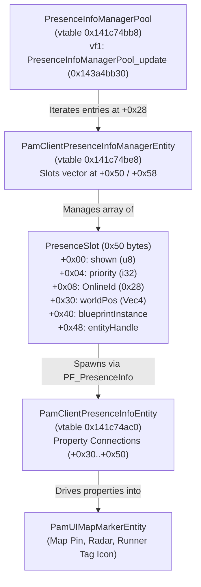
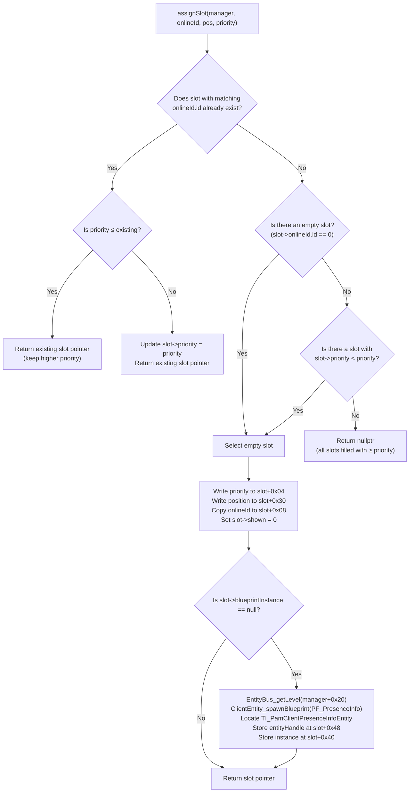

# Map Markers and Presence Reverse Engineering & Marker Pipeline

> [!NOTE]
> **Status**: Reverse engineered from binary dump (`MirrorsEdgeCatalyst_dump_SCY.exe`, Image Base `0x140000000`) and validated against `MECMP` reference implementation (`players_map.cpp` / `players_map.h`). Database annotations added to [`db/annotations/ui.yaml`](https://github.com/CodeNameMeteor/Gridnode/blob/main/db/annotations/ui.yaml) and [`db/annotations/online.yaml`](https://github.com/CodeNameMeteor/Gridnode/blob/main/db/annotations/online.yaml).
> **Confirmation Status**: Pure research for now; to be confirmed in game during live gameplay testing.

---

## 1. Executive Summary

Mirror's Edge Catalyst features an integrated world map and HUD friend radar system designed to visualize connected players and Origin/EA friends in the City of Glass. The system bridges Frostbite entity management, social gateway networking, and the Scaleform/UI rendering pipeline:

1. **Entity Management**: `PresenceInfoManagerPool` coordinates level-specific `PamClientPresenceInfoManagerEntity` instances that maintain fixed-capacity slot arrays (typically 5 to 16 slots, configured via `PamSocialPlaySettings`).
2. **Prefab Spawning**: Each active marker is driven by a dynamically instantiated prefab blueprint (`Gameplay/Social/Presence/PF_PresenceInfo`). Spawning occurs lazily upon the first assignment of a slot and yields a `PamClientPresenceInfoEntity` that exposes property connections for transform, visibility, and account identity.
3. **UI Projection & Runner Tags**: The marker's 3D world position is projected to the 2D fullscreen map and mini-radar via `PamUIMapMarkerEntity`. The player's customized Runner Tag (badge emblem, echo icon, background banner) is resolved asynchronously by the game's online gateway using the player's 64-bit Nucleus account ID.

This document details the exact memory layouts, virtual tables, slot eviction algorithms, hook points, and alignment requirements necessary to inject, update, and persist custom multiplayer markers.

---

## 2. Subsystem Architecture & Class Hierarchy



### 2.1 Virtual Function Tables & Factory Functions

| Component | Vtable VA | Creator / Hook Slot | Factory / Function VA | Description |
|---|---|---|---|---|
| `PresenceInfoManagerPool` | `0x141c74bb8` | Slot 1: `0x141c74bc8` | `0x143a4bb30` | Pool manager updating all active presence entities |
| `PamClientPresenceInfoManagerEntity` | `0x141c74be8` | Creator: `0x141c74cb8` | `0x143a35310` (ctor `0x143a38de0`) | Level presence manager entity |
| `PamClientPresenceInfoEntity` | `0x141c74ac0` | - | `0x143a35250` (ctor `0x143a38c10`) | Entity spawned inside `PF_PresenceInfo` |
| `PresenceInfoManager_assignSlot` | - | Direct Call | `0x143a405e0` | Assigns or updates a presence slot |
| `PresenceInfoManager_update` | - | Direct Call | `0x143a50b80` | Per-frame manager slot update routine |
| `PresenceInfoManager_publishOwnWorldPosition` | - | Direct Call | `0x143a4dad0` | Serializes local player position to JSON |
| `g_ownPresenceUser` | - | Pointer `0x14257cc68` | - | Global holding local player's `OnlineId` at `+0x30` |

---

## 3. Data Structures & Memory Layout

### 3.1 `OnlineId` (`0x28` / 40 bytes)
Frostbite identity structure uniquely identifying an EA Origin / Nucleus account.
- **Copy Constructor**: `0x1432f8cd0` (`OnlineId_copyConstruct(void* dst, const void* src)`).

```cpp
struct OnlineId {
    uint64_t id;         // +0x00: EA Nucleus / Origin persona account ID (0 while offline)
    char     name[32];   // +0x08: Null-terminated player display name
};
static_assert(sizeof(OnlineId) == 0x28, "OnlineId size mismatch");
```

### 3.2 `PresenceSlot` (`0x50` / 80 bytes)
Maintained in a contiguous `std::vector` inside `PamClientPresenceInfoManagerEntity` at `+0x50` (begin) and `+0x58` (end).

| Offset | Type | Field Name | Description |
|---|---|---|---|
| `+0x00` | `uint8_t` | `shown` | Privacy/visibility state (`1` = visible on map/radar, `0` = hidden). Re-evaluated per frame. |
| `+0x01` | `uint8_t[3]` | `_pad` | Structure padding (aligns priority to 4 bytes). |
| `+0x04` | `int32_t` | `priority` | Eviction priority. Game social friends use `0`; mods use `1000` to prevent replacement. |
| `+0x08` | `OnlineId` | `onlineId` | 40-byte account identity (`+0x08` id, `+0x10` name). |
| `+0x30` | `float[4]` | `worldPos` | 3D world coordinates $(x, y, z, w)$. **Must be 16-byte aligned** for `MOVAPS`. |
| `+0x40` | `void*` | `blueprintInstance` | Pointer to instantiated `PF_PresenceInfo` blueprint instance. |
| `+0x48` | `void*` | `entityHandle` | Ref-counted pointer/handle to `PamClientPresenceInfoEntity`. |

> [!WARNING]
> **SIMD Alignment Requirement**: In `PresenceInfoManager_assignSlot` (`0x143a405e0`), the world position is read and copied using SSE `MOVAPS` at `0x143a40681`. Passing an unaligned `float[4]` on the stack (e.g., standard 4-byte stack alignment in MSVC) causes an immediate **General Protection Fault (`0xC0000005`)**. All position arguments must be decorated with `alignas(16)`.

### 3.3 `PamClientPresenceInfoManagerEntity` (Size $\ge$ `0x60` bytes)
Inherits from Frostbite `Entity` (vtable `0x141c74be8`).

| Offset | Type | Field Name | Description |
|---|---|---|---|
| `+0x20` | `void*` | `levelContext` | Level context pointer passed to `EntityBus_getLevel`. |
| `+0x28` | `void*` | `managerData` | Asset data pointer; `+0x18` holds the `Blueprint*` for `PF_PresenceInfo`. |
| `+0x39` | `uint8_t` | `isPaused` | Pause or suppression flag (`0` = active). |
| `+0x3c` | `float` | `updateInterval` | Online presence refresh period (default `10.0f` seconds). |
| `+0x40` | `float` | `updateTimer` | Remaining time until next friend presence pull and self position publish. |
| `+0x44` | `float` | `permissionsTimer`| Timer for periodic privacy/permissions check (default `300.0f` seconds). |
| `+0x48` | `uint32_t`| `slotCapacity` | Configured slot limit (read from `PamSocialPlaySettings + 0x20`). |
| `+0x50` | `PresenceSlot*` | `slotsBegin` | Pointer to start of contiguous slot array. |
| `+0x58` | `PresenceSlot*` | `slotsEnd` | Pointer to end of contiguous slot array. |

### 3.4 `PresenceInfoManagerPool` & Pool Entries
The pool (vtable `0x141c74bb8`) holds a vector of active managers at `+0x28` (begin) and `+0x30` (end). Each entry is `0x10` (16) bytes:

```cpp
struct PresencePoolEntry {
    PamClientPresenceInfoManagerEntity* manager;         // +0x00: Level presence manager pointer
    uint16_t                            intervalTicks;   // +0x08: Update interval in engine ticks
    uint16_t                            currentTick;     // +0x0a: Elapsed engine ticks
    float                               accumulatedTime; // +0x0c: Accumulated delta time (seconds)
};
static_assert(sizeof(PresencePoolEntry) == 0x10, "PresencePoolEntry size mismatch");
```

### 3.5 `PamClientPresenceInfoEntity` (Property Map)
Constructed at `0x143a38c10` (vtable `0x141c74ac0`), this entity binds Frostbite dynamic properties to the UI marker:

| Offset | Property Hash | Property TypeInfo | Bound Semantic |
|---|---|---|---|
| `+0x30` | `0xbf943de7` | `fb::TI_LocalizedString` | Player display name string (tooltip label) |
| `+0x38` | `0x7f30d4fe` | `fb::TI_LinearTransform` | 4x4 transform matrix (sets translation $[x, y, z]$) |
| `+0x40` | `0xbb211b07` | `fb::TI_PamOnlineIdData` | Nucleus account ID (triggers Runner Tag asset load) |
| `+0x48` | `0x0d6ef4f3` | `fb::TI_Boolean` | `Valid` state flag |
| `+0x50` | `0xcacba3e1` | `fb::TI_Boolean` | `Shown` visibility flag (mirrors `slot->shown`) |

---

## 4. Slot Allocation and Eviction Mechanics (`0x143a405e0`)

The game assigns marker slots through `PresenceInfoManager_assignSlot`:
```cpp
void* PresenceInfoManager_assignSlot(
    void* manager, 
    const OnlineId* onlineId, 
    const float* position, // alignas(16) Vec4
    int priority
);
```

### 4.1 Eviction Logic Flow



### 4.2 Priority Values in Game vs Mods
- **Native Game Social Friends**: Always passed with `priority = 0`.
- **GridNode / MECMP Multiplayer**: Passed with `priority = 1000`.
- **Result**: Once a custom player occupies a slot at priority `1000`, the game's native background queries to EA friend services (`FUN_143a43d60`) will **never** evict or overwrite the mod's player marker, even when friend counts exceed slot capacity.

---

## 5. Hooking and Injection Pipeline

### 5.1 Hook Location: `PresenceInfoManagerPool_update`
The pool update function is intercepted via virtual method table patching on the pool instance:
- **Hook Address (Vtable Slot 1)**: `0x141c74bc8` (`Slot_PresenceInfoManagerPoolUpdate`)
- **Original Function**: `0x143a4bb30` (`Fn_PresenceInfoManagerPoolUpdate`)
- **Execution Context**: Client main game thread (`Main`).

```cpp
using PoolUpdateFn = void (*)(void* pool, void* updateInfo);
static PoolUpdateFn g_origPresencePoolUpdate = nullptr;

void hookedPresencePoolUpdate(void* pool, void* updateInfo) {
    // 1. Execute custom marker injection before the game updates entity properties
    PresenceMarkerSystem::getInstance().update(pool);

    // 2. Call original game function to propagate slot data into entities and UI
    g_origPresencePoolUpdate(pool, updateInfo);
}
```

### 5.2 Per-Frame Marker Maintenance Algorithm

When `update(pool)` runs:
1. **Iterate Active Managers**: Read the pool entries vector at `pool + 0x28` / `+0x30`. For each entry, verify that `manager != nullptr` and `*reinterpret_cast<uintptr_t*>(manager) == 0x141c74be8` (`Vtbl_PamClientPresenceInfoManagerEntity`).
2. **Prune Stale Level References**: If a level transition occurred, slots bound to old manager pointers are discarded.
3. **Evict Disconnected / Timed-Out Players**: For all slots placed by the mod:
   - If a player left the session or has not sent packets within $T_{\text{timeout}}$ (default $5\,000\text{ ms}$):
   - Clear the slot: write `shown = 0` (`slot + 0x00`), `priority = 0` (`slot + 0x04`), and zero out `onlineId` (`slot + 0x08`).
4. **Assign or Update Active Players**: For each connected multiplayer remote:
   - Search the manager's slot vector (`manager + 0x50` .. `+0x58`) for `slot->onlineId.id == remote.onlineId`.
   - If not found, call `PresenceInfoManager_assignSlot(manager, &remote.onlineId, alignedPos, 1000)`.
   - Update `slot->worldPos` with the player's latest 3D position.
   - Assert `slot->shown = 1` (must be written every frame, as native privacy checks may clear it).

---

## 6. Runner Tag Resolution & Offline Considerations

### 6.1 The Runner Tag Pipeline
In Mirror's Edge Catalyst, player map icons do not use generic static blips. Instead, the game displays the player's personal **Runner Tag**:
- **Background Banner**: Color gradient and texture style.
- **Echo Icon**: Runner silhouette / geometric emblem.
- **Badge**: Unlocked achievement/progression pin.

The game resolves Runner Tags asynchronously:
1. When `PresenceInfoManager_assignSlot` binds `slot->onlineId.id`, `PamClientPresenceInfoEntity` passes the ID to `fb::TI_PamOnlineIdData` at `+0x40`.
2. The UI system passes the ID to the online gateway cache.
3. If connected to EA servers or a private backend (e.g. *Beat Revival*), the tag textures are loaded and rendered above the 3D pin and in the map tooltip.

### 6.2 Offline Behavior & Solo Testing
- **Offline / Disconnected**: If `onlineId.id == 0` or offline services are unavailable, the tag asset fails to load, leaving the marker icon blank or invisible.
- **Solo-Test Loopback Mirror**: To verify map marker rendering in single-player or offline testing, read the local player's own online ID from:
  $$\text{pOwnPresence} = *\text{reinterpret\_cast}<\text{uintptr\_t}*>(0x14257cc68)$$
  $$\text{localOnlineId} = *\text{reinterpret\_cast}<\text{OnlineId}*>(\text{pOwnPresence} + 0x30)$$
  Passing the local player's `OnlineId` mirrors the local Runner Tag onto the injected slot.

---

## 7. Clean C++ Integration Interface

The following production-ready class wraps the entire presence and map marker system for GridNode:

```cpp
#pragma once
#include <cstdint>
#include <vector>
#include <string>
#include <memory>

namespace gridnode::ui {

struct OnlineId {
    uint64_t id;
    char name[32];
};

struct alignas(16) AlignedVec4 {
    float x, y, z, w;
};

struct PresenceMarker {
    uint64_t playerId;
    OnlineId identity;
    AlignedVec4 position;
    uint32_t lastUpdateMs;
    bool active;
};

class PresenceMarkerSystem {
public:
    static PresenceMarkerSystem& getInstance();

    // Lifecycle
    bool installHook();
    void removeHook();

    // Remote player registration
    void updatePlayer(uint64_t playerId, const std::string& name, float x, float y, float z);
    void removePlayer(uint64_t playerId);
    void clearAllPlayers();

    // Called internally from hooked PresenceInfoManagerPool_update
    void onPoolUpdate(void* pool);

private:
    PresenceMarkerSystem() = default;
    void updateManagerSlots(uintptr_t manager);

    struct TrackedSlot {
        uintptr_t manager;
        uint64_t  playerId;
    };

    std::vector<PresenceMarker> m_players;
    std::vector<TrackedSlot>    m_activeSlots;
    uintptr_t                   m_origPoolUpdate = 0;
    bool                        m_hookInstalled = false;
};

} // namespace gridnode::ui
```

---

## 8. Areas Needing Even More Research

While the slot allocation, eviction, and entity updating pipelines are thoroughly mapped and verified against binary and reference implementations, the following areas require further reverse engineering:

1. **Offline / Custom Tag Injection**:
   - Investigate whether the Scaleform UI marker symbol (`PamUIMapMarkerEntity`) can be hijacked via ActionScript or property overrides to display custom icon textures or color tints without requiring EA Nucleus authentication.
2. **Marker Geometry & 3D Pin Substitution**:
   - Decompile `PamUIMapMarkerEntity` to determine if the 3D in-world pin mesh and raycast beacon can be customized or recolored per team/player role.
3. **Tooltip Custom Formatting**:
   - Trace property connector `+0x30` (`TI_LocalizedString`) to support multi-line custom tooltips (e.g., displaying player ping, speed, or current district zone alongside player name).
