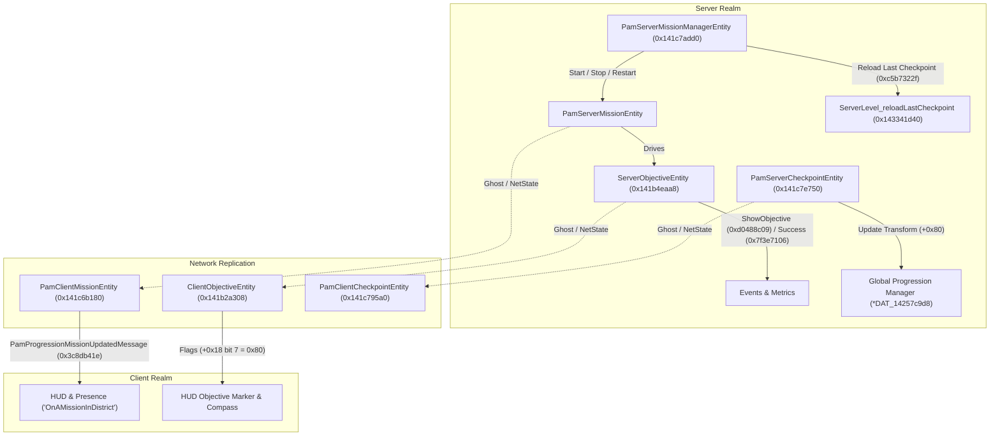

# Missions, Objectives & Custom Checkpoint Scripting

This document reverse-engineers the gameplay progression engine in Mirror's Edge Catalyst: the Mission State Machine (`PamServerMissionManagerEntity`, `PamClientMissionEntity`), the Objective Subsystem (`ServerObjectiveEntity`, `ClientObjectiveEntity`), and the Checkpoint & Respawn Pipeline (`PamServerCheckpointEntity`, `PamCheckpointEntityData`, `ServerLevel_reloadLastCheckpoint`). It provides exact byte offsets, vtable layouts, event hashes, and architectural blueprints for custom mission scripting and arbitrary checkpoint placement.

---

## 1. Executive Summary & Subsystem Architecture

Gameplay progression is partitioned across three tightly coordinated tiers:



---

## 2. Mission Lifecycle & State Machine

### A. `PamServerMissionManagerEntity` (Vtable `0x141c7add0`)
The mission manager coordinates all active level missions. Its event dispatcher `vf4` (`0x143a74bf0`) handles high-level mission directives:

| Event Hash | Hex | Name | Function / Effect |
|---|---|---|---|
| `0x68fb16fc` | `0x68fb16fc` | **StartMission** | Iterates all running missions via `TI_PamServerMissionEntity`, stops them via `0x143a79520`, sets state 2 (InProgress) at `mission + 0x124`, and starts target mission via `0x143a77640`. |
| `-0xda71f25` | `0xf258e0db` | **RestartCurrentMission** | Calls `0x143a79b40` to reset mission blueprint state and reposition Faith. |
| `-0x3a48cdd1` | `0xc5b7322f` | **GetLastCheckpointTransform** | Reads 64-byte `LinearTransform` from `*DAT_14257c9d8 + 0xe0` and writes to output property `0xd9db5473` (`this + 0x60`). |
| `0x41ee0da7` | `0x41ee0da7` | **AbandonMission** | Flags mission failed (`0x0e0c7a78`), updates state index at `DAT_14257c9d8 + 0x298`, and calls `0x1439e0720`. |
| `0x37bb9bfc` | `0x37bb9bfc` | **CompleteMission** | Evaluates mission success condition (`0x1439d9510`) and triggers level reset/completion sequence (`0x1439e07e0`). |
| `0x7dd57ba0` | `0x7dd57ba0` | **QueryMissionStatus** | Writes active mission state to output property at `this + 0x58`. |

### B. Property Connections in `PamServerMissionManagerEntity`
- `0xdd9b1fde` (`Boolean` at `this + 0x40`): `IsMissionActive`
- `0x0e0c7a78` (`Boolean` at `this + 0x48`): `IsMissionFailed`
- `0x4d2c209a` (`LinearTransform` at `this + 0x58`): `MissionStartTransform`
- `0xd9db5473` (`LinearTransform` at `this + 0x60`): `LastCheckpointTransform`
- `0xd89799bd` (`Int32` at `this + 0x50`): `ActiveMissionId`

---

## 3. Client Mission Replication & Presence Hook

### A. `PamClientMissionEntity` (Vtable `0x141c6b180`, Size `0x78`)
- Class info: `TI_PamClientMissionEntity` (`0x14285f9e8`), type ID `0x00700035`.
- Secondary vtable at `this + 0x30` (`0x141c6b238`): Network deserialization interface.
- Network deserializer `FUN_143a17370` unpacks bitstream flags into:
  - `+0x58`: `isStarted` (`uint8_t`, 1 = active)
  - `+0x59`: `isPaused` (`uint8_t`, 1 = paused)
  - `+0x5a`: `isInDistrict` (`uint8_t`, 1 = within district)
  - `+0x5b`: `isCompleted` (`uint8_t`, 1 = completed)
  - `+0x68`: Property connector for `0x46f8e52e` (`MissionId`, `Int32`).

### B. Progression Broadcast & Presence Integration
When mission state bits change:
1. `FUN_143a1a2d0` queues `PamProgressionMissionUpdatedMessage` (`0x3c8db41e`, category `0xae19b9ac`) to `ClientGameContext->messageManager` (`0x142401cb0 + 0x10`).
2. Presence update routine `FUN_143a0df00` intercepts the message:
   - If `isInDistrict` (`mission + 0x5a != 0`): sets presence activity to `"OnAMissionInDistrict"`.
   - If idle / free-roam: sets presence activity to `"InDistrict"`.
   - Links directly to `PresenceInfoManagerPool` (`0x141c74bb8`) and social play presence replication.

---

## 4. Objectives Subsystem Architecture

### A. `ServerObjectiveEntity` (Vtable `0x141b4eaa8`, Size `0x100`)
Manages task objectives (e.g. "Reach the conduit", "Evade KrugerSec", "Hack the terminal").
- Event dispatcher `vf4` (`0x143383810`) handles 3 primary event hashes:

| Event Hash | Hex | Name | Function / Effect |
|---|---|---|---|
| `-0x2fb773f7` | `0xd0488c09` | **ShowObjective** | Sets `isActive = 1`, `isStarted = 1` (`+0xed`), resets timer to `0.0f` (`+0xe0`), fires `0x87add7e8` (`OnStarted`), dirties `NetState`. |
| `0x23ccf4aa` | `0x23ccf4aa` | **HideObjective** | Clears active flag (`+0xed = 0`), fires `0x5b2a72cb` (`OnStopped`), unregisters from active objectives list (`DAT_142548500`). |
| `0x7f3e7106` | `0x7f3e7106` | **Success** | Validates completion criteria (`0x1433888d0`), sets `isCompleted = 1` (`+0xec`), calls `0x14338d310`. |

- **Completion Pipeline (`0x14338d310`)**:
  - Fires blueprint output event `0xbb06a967` (`OnSuccess`).
  - Posts `ServerMetricsObjectiveSuccessMessage` (`0x60291090`, category `0x12068db7`) to `ServerGameContext->messageManager`.
  - Propagates success up composite tactical objective trees (`this + 0xf0`).

### B. `ClientObjectiveEntity` (Vtable `0x141b2a308`, Size `0xf8`)
- Class info: `TI_ClientObjectiveEntity` (`0x1427f4778`).
- Secondary vtable at `this + 0x30` (`0x141b2a3c0`): Client network receiver.
- Flags at `this + 0x18`:
  - Bit 7 (`0x80`): Active / Shown state on HUD.
  - Toggled dynamically by `0x1432a9ab0` (`TEST DL, DL; JNZ -> OR [RCX-0x18], 0x80`).
  - When asserted, draws the 3D objective waypoint on the player's screen and compass.

---

## 5. Checkpoints & Level Reload Pipeline

### A. `PamServerCheckpointEntity` (Vtable `0x141c7e750`, Size `0x150`)
Represents an in-world checkpoint volume that records Faith's progress.

| Offset | Type | Name | Description |
|---|---|---|---|
| `+0x60` | `uint8_t` | `isEnabled` | 1 when active (property `0x0028a000`) |
| `+0x61` | `uint8_t` | `isTriggered` | 1 when passed / triggered (property `0x41a181ba`) |
| `+0x62` | `uint8_t` | `isInDistrict` | 1 when in district (property `0x710a670c`) |
| `+0x63` | `uint8_t` | `isSilent` | Silent checkpoint flag (property `0x0c51e7bf`) |
| `+0x64` | `uint8_t` | `isRespawnHere` | Respawn flag (property `0x7c83e30f`) |
| `+0x70` | `uint32_t` | `checkpointIndex` | Checkpoint sequence number (property `0x0cc9279b`) |
| `+0x80` | `LinearTransform` | `spawnTransform` | 64-byte world transform where Faith respawns (property `0x87525469`) |
| `+0xc0` | `float` | `triggerRadius` | Trigger volume half-extent / radius (property `0x4ddbe821`) |
| `+0xd0` | `LinearTransform` | `triggerTransform` | Trigger volume orientation and position (property `0xae496a36`) |

- **Event Handler `vf4` (`0x143a83e00`)**:
  - `0x77555b29`: **TriggerCheckpoint** -> updates manager, fires `0xfca266bb` (`OnTriggered`).
  - `0x354b88cf`: **ResetCheckpoint** -> resets state, fires `0x02edc343` (`OnReset`).
- **Transform Setter (`0x143a860b0`)**:
  - Writes new spawn transform to `+0x80` and sequence index to `+0x70`.
  - Dispatches property updates `0x87525469` (`spawnTransform`) and `0x0cc9279b` (`checkpointIndex`).
  - Dirties network state flags `NetState_setDirty(this + 0x30, 6)`.

### B. Level Reload to Checkpoint
When Faith dies, restarts from checkpoint, or falls off a building:
1. `DAT_14257c9d8` stores the active checkpoint transform:
   - `*DAT_14257c9d8 + 0xe0`..`+0x11f`: 64-byte `LinearTransform` (Faith's reload position and facing).
2. `ServerLevel_reloadLastCheckpoint` (`0x143341d40`):
   - Allocates `ServerRoundResetMessage` (`0x4bb8de5c`, category `0xd93dd7c2`).
   - Allocates `ServerLevelRestartMessage` (`0xf8429a0e`, category `0xc6e40ba0`).
   - Executes both on `ServerGameContext->messageManager` (`0x14253d670 + 0x10`).
   - Teleports Faith to `*DAT_14257c9d8 + 0xe0` and restores dynamic level props.

---

## 6. Custom Scripting Recipes for GridNode Mods

### Recipe 1: Arbitrary Custom Checkpoint Placement Anywhere on the Map
A mod can place a custom respawn point at any 3D coordinate without modifying level assets:
```cpp
// Write directly to the engine's active checkpoint transform buffer
void setCustomCheckpoint(const gn_transform& t) {
    uintptr_t progressionMgr = mem::readOr<uintptr_t>(mem::rva(0x14257c9d8));
    if (!progressionMgr) return;
    
    // Convert gn_transform to Frostbite LinearTransform (right, up, forward, trans)
    mem::write<gn_transform>(progressionMgr + 0xe0, t);
    
    // Unlock checkpoint override flag
    mem::write<uint8_t>(progressionMgr + 0x2b0, 0);
}
```

### Recipe 2: Programmatic Checkpoint Reload
To instantly reload Faith to the active or custom checkpoint (reloading props, resetting alert states):
```cpp
void reloadCheckpoint() {
    // Call ServerLevel_reloadLastCheckpoint (0x143341d40)
    using ReloadFn = void (*)(void* levelContext, uint32_t unk1, uint8_t unk2);
    auto reload = reinterpret_cast<ReloadFn>(mem::rva(0x143341d40));
    
    uintptr_t serverContext = mem::readOr<uintptr_t>(mem::rva(0x14253d670));
    uintptr_t level = serverContext ? mem::readOr<uintptr_t>(serverContext + 0x118) : 0;
    if (level) {
        reload(reinterpret_cast<void*>(level), 1, 0);
    }
}
```

### Recipe 3: Triggering Objectives & Custom Waypoint Markers
To programmatically pop an objective on the player's screen:
```cpp
void triggerObjective(void* serverObjectiveEntity) {
    // Send event ShowObjective (0xd0488c09) to ServerObjectiveEntity
    gn_event ev{};
    ev.event_id = 0xd0488c09; // ShowObjective
    gn::send_event(serverObjectiveEntity, &ev);
}

void completeObjective(void* serverObjectiveEntity) {
    // Send event Success (0x7f3e7106) to ServerObjectiveEntity
    gn_event ev{};
    ev.event_id = 0x7f3e7106; // Success
    gn::send_event(serverObjectiveEntity, &ev);
}
```

---

## 7. In-Game Verification Test Plans

### Test 1: Custom Checkpoint Respawn Verification
1. Position Faith on a rooftop or crane.
2. Read her current transform and write it into `*DAT_14257c9d8 + 0xe0`.
3. Jump off the building to trigger a death / out-of-bounds fall.
4. Verify that Faith respawns directly on the crane with exact position and orientation intact.

### Test 2: Programmatic Level Reload Verification
1. Move Faith into a combat encounter with KrugerSec guards.
2. Call `ServerLevel_reloadLastCheckpoint` (`0x143341d40`).
3. Verify that the round resets smoothly, guards reset to their patrol spawns, and Faith is repositioned at the checkpoint without hanging or crashing.

### Test 3: Objective Display & Success Event Verification
1. Hook `ServerObjectiveEntity_setSuccess` (`0x14338d310`).
2. Dispatch `Success` (`0x7f3e7106`) to an active objective.
3. Verify that the HUD objective checkmark animation plays, `OnSuccess` (`0xbb06a967`) fires, and telemetry message `0x60291090` is received.
