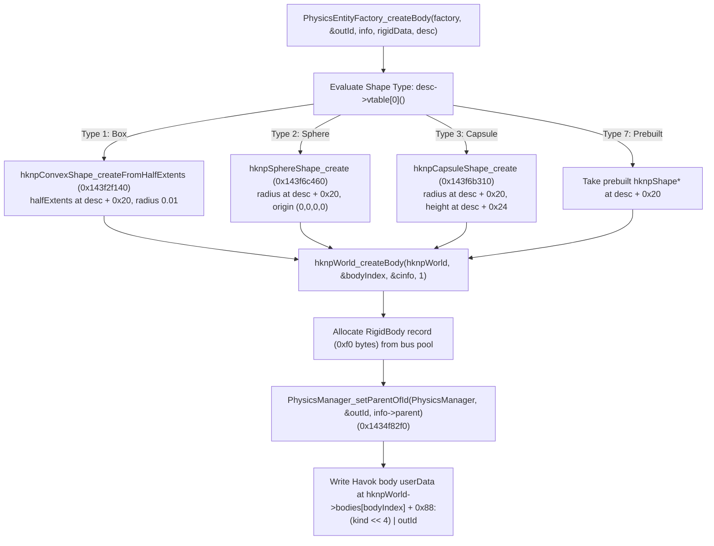
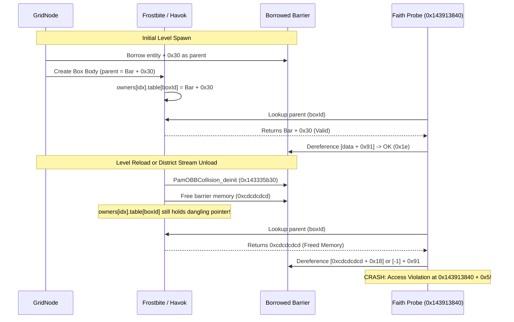

# Standalone Havok Collision & Touch Classification

> **Research Status (2026-11-06)**: The reverse engineering, disassembly analysis, and architectural design documented here are inferred from static analysis in Ghidra on binary `MirrorsEdgeCatalyst_dump_SCY.exe` (Image Base `0x140000000`, Build `0x5762E3B7`). All findings, offsets, and dummy entity layouts are **purely research for now, to be confirmed in future in-game runtime testing**.
> Relevant annotations have been cataloged in [`db/annotations/physics.yaml`](file:///D:/Dev/GridNode/db/annotations/physics.yaml).

---

## 1. Executive Summary & Problem Statement

In GridNode API 34, native Havok collision boxes (`boxBackendNative`) were successfully created through the game's internal physics factory (`PhysicsEntityFactory_create` at `0x1435169e0` / `0x143516450`). However, the implementation had a critical limitation: it depended on borrowing setup records from a live level barrier (`PamOBBCollisionEntity`):
1. **Level Load Delay**: GridNode had to wait 3 seconds after level load before spawning collision boxes, waiting for the game's streaming pipeline to instantiate a live barrier to borrow.
2. **Dangling Pointer Crash on Level Reload / Unload**: When a level reloads, or when district streaming unloads the area containing the borrowed barrier, the engine executes `PamOBBCollision_deinit` (`0x143335b30`) and frees the barrier entity. The box's registered parent pointer in `PhysicsManager` becomes dangling memory (`0xcdcdcdcd`). As soon as Faith touches the custom box, the character contact probe calls `SurfaceTouch_classifyBody` (`FUN_143913840`), which dereferences `plVar2[-1] + 0x91`, causing an instant Access Violation crash (`FUN_143913840 + 0x5`).

This document reverse-engineers the exact body registration mechanism, the surface touch classifier, and designs a **100% standalone, pinned static dummy entity solution**. This eliminates the barrier dependence completely, removes the 3-second delay, prevents any level-transition crashes, and unlocks support for other Havok shapes (Spheres, Capsules, and Prebuilt Meshes).

---

## 2. Reverse Engineering: Physics Creation & Parent Registration

### 2.1 PhysicsCreationInfo Constructor (`0x142d4d1a0`)

When a physics entity creates a collision body, it initializes a `PhysicsCreationInfo` structure on the stack (size $\ge 0\text{xd4}$ bytes):

```c
// 0x142d4d1a0: PhysicsCreationInfo_ctor
void* PhysicsCreationInfo_ctor(
    void* info,
    void* bus,
    uint32_t realm,     // 0 = Client, 1 = Server
    void* owner,         // PhysicsOwner pointer
    void* parent         // Registered parent object (entity + 0x30 in barriers)
);
```

#### Memory Layout of `PhysicsCreationInfo`:
| Offset | Type | Description |
|---|---|---|
| `+0x00` | `void*` | Property bus pointer (`bus`). Reads pool allocator at `*(bus->entity + 0x38) + 0x58`. |
| `+0x10` | `uint32_t` | Realm index ($0 = \text{Client}$, $1 = \text{Server}$). |
| `+0x20` | `uint32_t` | Material / spatial flags (`0xff`). |
| `+0x30`..`+0x6f` | `LinearTransform` | Initial transform (4x4 matrix), filled via `0x14314df80(bus)`. Defaults to identity if `bus->entity == nullptr`. |
| `+0xc0` | `void*` | Owning `PhysicsOwner*` (`owner`). |
| `+0xc8` | `void*` | Registered `parent*` (`parent`). |

### 2.2 PhysicsEntityFactory_createBody (`0x143516450`)

`PhysicsEntityFactory_create` is a 32-byte jump stub to `PhysicsEntityFactory_createBody` (`0x143516450`). Its execution flow is:



At line 160 of `FUN_143516450`:
```c
uVar10 = FUN_143506bc0(*(undefined8 *)(local_2b0 + 0x18), &fb::TI_PhysicsManager);
FUN_1434f82f0(uVar10, &local_2c4, param_3[0x19]);
```
`param_3[0x19]` is `info->parent` (offset `+0xc8`). It calls `PhysicsManager_setParentOfId` (`0x1434f82f0`).

### 2.3 The PhysicsManager Owner Table (`0x1434f82f0` & `0x1434ee250`)

In `PhysicsManager` (`ClientGameWorld + 0x50`):
- `*(manager + 0xf8)` is an array of Owner descriptors (each `0x20` = 32 bytes).
- The owner index is extracted from byte 2 of the body ID:
  $$\text{ownerIdx} = (\text{bodyId} \gg 16) \ \& \ 0\text{xff}$$
- The object table pointer is at `*(manager->owners[ownerIdx] + 0x00)`.
- The entry is indexed by the low 16 bits of the body ID:
  $$\text{entry} = \text{table}[\text{bodyId} \ \& \ 0\text{xffff}]$$

#### `PhysicsManager_setParentOfId` (`0x1434f82f0`):
```c
void PhysicsManager_setParentOfId(void* manager, const uint32_t* bodyId, void* parent)
{
    uint8_t ownerIdx = (uint8_t)(*bodyId >> 16);
    uint16_t localIdx = (uint16_t)(*bodyId & 0xffff);
    uintptr_t ownerDesc = *(uintptr_t*)(manager + 0xf8) + ownerIdx * 0x20;
    void** table = *(void***)ownerDesc;
    
    // Automatically resizes table if localIdx >= capacity
    table[localIdx] = parent;
}
```

#### `PhysicsManager_objectOfId` (`0x1434ee250`):
```c
void* PhysicsManager_objectOfId(void* manager, const uint32_t* bodyId)
{
    uint8_t ownerIdx = (uint8_t)(*bodyId >> 16);
    uint16_t localIdx = (uint16_t)(*bodyId & 0xffff);
    uintptr_t ownerDesc = *(uintptr_t*)(manager + 0xf8) + ownerIdx * 0x20;
    void** table = *(void***)ownerDesc;
    
    return table[localIdx];
}
```

---

## 3. The Surface Touch Classifier (`FUN_143913840`)

When Faith touches or stands on any Havok collision body, the character contact probe (`0x142f450c0`) passes the contact body ID into `SurfaceTouch_classifyBody` (`FUN_143913840`):

```c
uint32_t SurfaceTouch_classifyBody(void* probeContext, uint32_t bodyId, uint32_t partIndex);
```

### 3.1 Disassembly Walkthrough (`0x143913840` to `0x143913afb`)

```assembly
143913882: MOV RCX, qword ptr [ClientGameWorld + 0x50] ; PhysicsManager
14391388b: CALL 0x1434ee250                          ; PhysicsManager_objectOfId
143913890: MOV RDI, RAX                              ; RDI = parent
143913893: TEST RAX, RAX
143913896: JZ 0x143913aec                            ; If parent == null -> return 0 (INTANGIBLE)
14391389c: MOV RAX, qword ptr [RAX]                  ; parent->vtable
14391389f: MOV RCX, RDI                              ; this
1439138a7: CALL qword ptr [RAX + 0x18]               ; vtable[3]: getTypeInfo()
...
; Check if parent inherits from fb::TI_PamOBBCollisionEntity (0x142858650, classId 1001)
143913a27: MOVZX ECX, word ptr [0x142858678]        ; classId = 1001
143913a2e: MOVZX EDX, word ptr [RAX + 0x28]         ; typeInfo->classId
143913a32: MOVZX EAX, word ptr [0x14285867a]        ; lastSubClassId = 1001
143913a39: SUB EAX, ECX
143913a3b: SUB EDX, ECX
143913a3d: CMP EDX, EAX
143913a3f: JA 0x143913a4a                           ; Not PamOBBCollisionEntity -> check Sphere / Capsule
143913a41: LEA RCX, [RDI - 0x30]                    ; RCX = entity = parent - 0x30
143913a45: TEST RCX, RCX
143913a48: JNZ 0x143913a76
...
; Extract Traversal Permissions from entity->data
143913a76: MOV RCX, qword ptr [RCX + 0x28]          ; RCX = entity->data
143913a7a: MOV EAX, 0x2
143913a7f: CMP byte ptr [RCX + 0x91], BL            ; data + 0x91: canVault
143913a85: CMOVNZ EBX, EAX                          ; bit 1 (0x02)
143913a88: CMP byte ptr [RCX + 0x90], 0x0           ; data + 0x90: canClimb
143913a8f: JZ 0x143913a94
143913a91: OR EBX, 0x4                              ; bit 2 (0x04)
143913a94: CMP byte ptr [RCX + 0x92], 0x0           ; data + 0x92: canStand
143913a9b: JZ 0x143913aa0
143913a9d: OR EBX, 0x8                              ; bit 3 (0x08)
143913aa0: CMP byte ptr [RCX + 0x93], 0x0           ; data + 0x93: canWallrun
143913aa7: JZ 0x143913ae7
143913aa9: OR EBX, 0x10                             ; bit 4 (0x10)
143913aac: JMP 0x143913ae7
...
; Capsule Collision Fallback (0x143913ab1)
143913aba: MOVZX ECX, word ptr [0x1428303c8]        ; Check fb::TI_ClientCapsuleCollisionComponent
...
143913ad6: MOV EBX, 0x1e                            ; Directly returns 0x1e!
```

### 3.2 Traversal Return Bitmask

The return value of `SurfaceTouch_classifyBody` controls Faith's movement state machine:
- `0x00`: Intangible (no contact, Faith slips through or cannot initiate moves).
- `0x02`: Vault permitted (`canVault`, byte `+0x91`).
- `0x04`: Climb permitted (`canClimb`, byte `+0x90`).
- `0x08`: Stand / Walk permitted (`canStand`, byte `+0x92`).
- `0x10`: Wallrun permitted (`canWallrun`, byte `+0x93`).
- **`0x1e`** ($2 \mid 4 \mid 8 \mid 16$): **Solid surface with full traversal capabilities**.

---

## 4. Root Cause of the Level Reload / Streaming Crash



Because GridNode borrowed `entity + 0x30` from a live barrier, unloading the barrier turned `table[boxId & 0xffff]` into a dangling pointer.

---

## 5. The Solution: Pinned Static Dummy Barrier Entity

To eliminate the barrier dependency completely, GridNode allocates a **permanent, pinned static dummy structure** in memory that satisfies all requirements of `SurfaceTouch_classifyBody` and the raycast hit resolver.

### 5.1 Structure Definitions

```cpp
// Pinned static data structure (size 0x98 bytes)
struct DummyBarrierData {
    uint8_t pad_00[0x90];
    uint8_t canClimb;    // +0x90: 1 (0x04 bit)
    uint8_t canVault;    // +0x91: 1 (0x02 bit)
    uint8_t canStand;    // +0x92: 1 (0x08 bit)
    uint8_t canWallrun;  // +0x93: 1 (0x10 bit)
    uint8_t pad_94[4];
};

// Pinned static entity structure (size 0x40 bytes)
struct DummyBarrierEntity {
    uint8_t pad_00[0x28];
    DummyBarrierData* data; // +0x28: points to s_dummyData
    void** vtable;          // +0x30: points to PamOBBCollision_SubobjectVtable (0x141c4e258)
    uint8_t pad_38[8];
};
```

### 5.2 The Native Subobject Vtable (`0x141c4e258`)

The game binary already has the exact read-only vtable for `entity + 0x30` in `PamOBBCollisionEntity` at address **`0x141c4e258`** (`PamOBBCollision_SubobjectVtable`):

| Slot | Offset | Function VA | Implementation & Purpose |
|---|---|---|---|
| `[0]` | `+0x00` | `0x142a1c590` | Stub / base dtor |
| `[1]` | `+0x08` | `0x142a1c590` | Stub |
| `[2]` | `+0x10` | `0x142a1c590` | Stub |
| `[3]` | `+0x18` | `0x143965ab9` | **`getTypeInfo` thunk**: `SUB RCX, 0x30; JMP 0x143965ab0` $\to$ returns `&fb::TI_PamOBBCollisionEntity` (`0x142858650`). |
| `[4]` | `+0x20` | `0x143334f70` | **`getEntity`**: `LEA RAX, [RCX - 0x30]; RET` $\to$ returns `&dummyEntity`. |
| `[5]` | `+0x28` | `0x142fcd470` | **Raycast filter**: `MOV AL, 1; RET` $\to$ returns `true` (solid hit for all ray casts in `0x1435188c0`). |

### 5.3 Execution Trace with Pinned Static Dummy

When creating a body:
```cpp
static DummyBarrierData s_dummyData = {};
static DummyBarrierEntity s_dummyEntity = {};

void init_standalone_collision() {
    s_dummyData.canClimb = 1;
    s_dummyData.canVault = 1;
    s_dummyData.canStand = 1;
    s_dummyData.canWallrun = 1;

    s_dummyEntity.data = &s_dummyData;
    s_dummyEntity.vtable = (void**)0x141c4e258; // Game's PamOBBCollision_SubobjectVtable
}

// In box creation:
void* parent = &s_dummyEntity.vtable; // Pointer to +0x30 subobject
PhysicsCreationInfo_ctor(&info, bus, 0, owner, parent);
```

1. **At Creation**: `PhysicsEntityFactory_createBody` writes `parent = &s_dummyEntity.vtable` into `PhysicsManager->owners[idx].table[boxId & 0xffff]`.
2. **At Contact**: Faith touches the box. `SurfaceTouch_classifyBody` calls `PhysicsManager_objectOfId` and receives `&s_dummyEntity.vtable`.
3. **Type Check**: Calls `vtable[3]` (`0x143965ab9`). The thunk subtracts `0x30`, jumps to `0x143965ab0`, and returns `&TI_PamOBBCollisionEntity`. Matches `0x142858650`!
4. **Data Read**: Subtracts `0x30` to get `&s_dummyEntity`, reads `s_dummyEntity.data` (`&s_dummyData`).
5. **Flags Read**: Reads `canClimb`, `canVault`, `canStand`, `canWallrun`. Returns **`0x1e`**!
6. **On Level Unload / Reload**: `s_dummyEntity` and `s_dummyData` are static memory inside GridNode! They are **never freed**.
7. **Zero-Second Wait**: No need to search for or borrow live barriers. Boxes can be created on frame 0 of world initialization.

---

## 6. Shape Creation Spectrum in `PhysicsEntityFactory_createBody`

`PhysicsEntityFactory_createBody` (`0x143516450`) switches on `desc->vtable[0](desc)` to create any Havok shape:

### Shape Type Matrix:
| Type ID | Havok Shape Class | Factory Routine | Description Layout |
|---|---|---|---|
| **1** | `hknpConvexPolytopeShape` (Box) | `hknpConvexShape_createFromHalfExtents` (`0x143f2f140`) | `+0x20`: Half extents $(h_x, h_y, h_z, 0)$. Convex radius hardcoded to $0.01\text{ m}$. |
| **2** | `hknpSphereShape` (Sphere) | `hknpSphereShape_create` (`0x143f6c460`) | `+0x20`: Radius $r$ (`float`). Origin $(0, 0, 0, 0)$. Shape size $0\text{x}80$, vtable `0x141d4f348`. |
| **3** | `hknpCapsuleShape` (Capsule) | `hknpCapsuleShape_create` (`0x143f6b310`) | `+0x20`: Radius $r$ (`float`), `+0x24`: Cylinder height $h$ (`float`). Endpoints $(0, 0, \pm 0.5h)$. Shape size $0\text{x}1b0$, vtable `0x141d4f448`. |
| **7** | Prebuilt Havok Shape | Direct assignment | `+0x20`: Direct pointer to existing `hknpShape*` (`hknpStaticCompoundShape`, `hknpCompressedMeshShape`, etc.). |

---

## 7. Server World Verification

In `PamOBBCollision_enable` (`0x143333310`):
- `lVar1 = (&GameWorlds)[collision->flags & 1];`
- When `collision->realm == 1` (Server Realm), `lVar1` points to `ServerGameWorld` (`GameWorlds[1]`).
- It looks up `PhysicsEntityFactory` in `ServerGameWorld + 0x58` via `PhysicsFactory_find(0x143506830)`.
- It executes the **exact same factory code** (`PhysicsEntityFactory_createBody`), passing realm = 1.
- Body records and owner tables live in `ServerGameWorld->physicsManager` (`ServerGameWorld + 0x50`).
- Therefore, the identical standalone dummy parent pattern functions seamlessly for the server world without requiring borrowed server barriers.

---

## 8. In-Game Verification & Test Plan

The following test procedure will confirm these reverse-engineered findings when running in the game:

1. **Frame-0 Spawn Test**:
   - Spawn a standalone native collision box immediately upon level transition without the 3-second delay timer.
   - *Verification*: Confirm box ID is registered in `PhysicsManager` and no null-barrier error occurs.
2. **Contact Traversal Test**:
   - Have Faith walk onto, jump on, vault over, and climb the standalone box.
   - *Verification*: Faith lands cleanly without slipping through or floating; traversal movements initiate normally.
3. **Level Reload Stability Test**:
   - Spawn 10 standalone boxes. Trigger a level reload (`restart_level` or death).
   - *Verification*: Verify zero crashes in `FUN_143913840 + 0x5` across 10 consecutive reloads.
4. **Streaming Boundary Test**:
   - Walk between streaming districts (e.g. Anchor to The View) while standalone collision boxes remain active.
   - *Verification*: No memory corruption or crashes when background streaming zones unload.
5. **Raycast Query Test**:
   - Fire a `raycast` / `RaycastQuery_execute` through the box.
   - *Verification*: Ray hits the box at fraction $< 1.0$ with accurate surface normal, and `0x1435188c0` evaluates `true`.
6. **Sphere and Capsule Spawn Test**:
   - Instantiate shape type 2 (Sphere) and type 3 (Capsule) via description vtable return.
   - *Verification*: Havok bodies instantiate with sphere and capsule shapes and collide with Faith.
