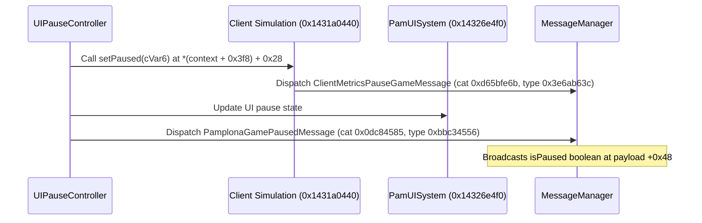

# UI Systems & Game Pause Architecture

> **Research Status (2026-11-06)**: The reverse engineering, disassembly analysis, and mathematical models documented here are inferred from static analysis in Ghidra on binary `MirrorsEdgeCatalyst_dump_SCY.exe` (Image Base `0x140000000`, Build `0x5762E3B7`). All findings, offsets, formulas, and API designs are **purely research for now, to be confirmed in future in-game runtime testing**.
> Relevant annotations have been cataloged in [`db/annotations/ui.yaml`](file:///D:/Dev/GridNode/db/annotations/ui.yaml).

---

## 1. Executive Summary & Problem Analysis

In GridNode API 32, `ui_pause_state` exposed the game's internal pause request counters from `UIPauseController` (`PamUISystem + 0x8c8`):
- `pauseRequestsA` (offset `+0x08`, standard pause requests)
- `pauseRequestsB` (offset `+0x0c`, full pause requests)

In in-game testing, the user observed:
> *"The pause counters read: `all 1, full-screen 0` with the pause menu open, and `0, 0` in play; the full-screen counter stayed 0 in every state."*

Item 5 of [`docs/research/open-research.md`](file:///D:/Dev/GridNode/docs/research/open-research.md#5-ui-and-pause) raised several key questions:
1. Which screens add to which counter, and what entity triggers them?
2. What are events `0x0dd8ddf7` and `0xc44b5c3c`?
3. What is the "time value" ($s$) read in `UIPauseController_applyToClient` (`0x143b16ae0`)?
4. How is the pause state evaluated, and why did $A = 1, B = 0$ pause the game when $B$ was 0?
5. How can mods reliably detect whether the game is paused, and how can a mod safely pause and resume the game?
6. What related mechanisms need further research?

This document answers all of these questions through reverse engineering of the UI pause pipeline.

---

## 2. Reverse Engineering: The UI Pause Pipeline

### 2.1 The `UIPauseController` Object

In `PamUISystem` (`0x9e0` bytes, singleton global `PamUISystemInstance` at `0x1424157f0`):
- Offset `+0x8c8` contains a **pointer** to `UIPauseController` (a 16-byte heap object allocated during `PamUISystem` constructor `0x143b0e8a0`).
- Vtable: `0x141be1f38` (`UIPauseController::vftable`).

#### Memory Layout:
| Offset | Type | Name | Purpose |
|---|---|---|---|
| `+0x00` | `void*` | `vftable` | `0x141be1f38` (virtual destructor) |
| `+0x08` | `int32_t` | `pauseRequestsA` | Standard pause request counter ($A$) |
| `+0x0c` | `int32_t` | `pauseRequestsB` | Full-screen / hard pause request counter ($B$) |

---

### 2.2 `UIPauseController_request` (`0x143b16210`)

`UIPauseController_request` modifies the counters via reference counting:

```c
void UIPauseController_request(void* controller, int8_t on, int8_t full)
{
    // Modify standard pause requests (A)
    if (on == 0) {
        *(int*)(controller + 0x08) -= 1;
    } else {
        *(int*)(controller + 0x08) += 1;
    }

    // Modify full pause requests (B)
    if (full != 0) {
        if (on != 0) {
            *(int*)(controller + 0x0c) += 1;
        } else {
            *(int*)(controller + 0x0c) -= 1;
        }
    }
}
```

Disassembly xref analysis in Ghidra revealed an unexpected architectural fact:
> **`UIPauseController_request` has exactly three callers in the entire game binary.** All three belong to a single entity class: `fb::PamClientUIPauseEntity`.

---

### 2.3 The Sole Driving Entity: `PamClientUIPauseEntity`

`PamClientUIPauseEntity` (`0x38` bytes, vtable `0x141cbd4a8`) is the sole Frostbite client entity responsible for requesting UI pauses.

#### Entity Layout:
- `+0x00`: vtable `0x141cbd4a8`
- `+0x28`: `PamUIPauseEntityData* data` (TypeInfo `0x142887770`, size `0x20`)
- `+0x30`: `uint8_t active` ($1$ while pause is requested, $0$ otherwise)

#### The Property: `PostponePauseUntilScreenIsFadedIn` (`data + 0x18`)
In `PamUIPauseEntityData`, offset `+0x18` is a boolean named:
$$\text{PostponePauseUntilScreenIsFadedIn}$$

- When `postpone == true` (`1`):
  `full = (data + 0x18 == 0)` evaluates to **`0`** (`false`).
  The entity calls `UIPauseController_request(ctrl, 1, 0)`.
  **Only $A$ (`pauseRequestsA`) is incremented.** $B$ remains $0$!
- When `postpone == false` (`0`):
  `full = (data + 0x18 == 0)` evaluates to **`1`** (`true`).
  The entity calls `UIPauseController_request(ctrl, 1, 1)`.
  **Both $A$ and $B$ are incremented.**

#### Entity Event Handler (`vf4` at `0x143b3ac80`):
```c
void PamClientUIPauseEntity::vf4(PamClientUIPauseEntity* this, EventData* event)
{
    int eventId = event->eventId; // at event + 0x8

    // Event 0x0dd8ddf7: Pause ON
    if (eventId == 0x0dd8ddf7) {
        if (this->active == 0) {
            this->active = 1;
            void* ctrl = *(void**)(PamUISystemInstance + 0x8c8);
            bool isFull = (*(char*)(this->data + 0x18) == 0);
            UIPauseController_request(ctrl, 1, isFull);
        }
        return;
    }

    // Event 0xc44b5c3c: Pause OFF
    if (eventId == 0xc44b5c3c) {
        if (this->active != 0) {
            this->active = 0;
            void* ctrl = *(void**)(PamUISystemInstance + 0x8c8);
            bool isFull = (*(char*)(this->data + 0x18) == 0);
            UIPauseController_request(ctrl, 0, isFull);
        }
        return;
    }
}
```

#### Safe Deinit / Teardown (`0x143b389b0`):
When the entity is destroyed or unloaded, if `this->active != 0`, it automatically calls:
`UIPauseController_request(ctrl, 0, *(data + 0x18) == 0)`
This guarantees that UI screen destruction never leaves dangling pause requests.

---

## 3. The "Time Value" & The Exact Pause Condition

### 3.1 What the "Time Value" Is

In `UIPauseController_applyToClient` (`0x143b16ae0`) and `UIPauseController_isPaused` (`0x143b12830`):
```c
uVar2 = FUN_1432a8d80(0); // local player 0's subview timing context
fVar7 = (float)FUN_1432a8710(uVar2); // timescale factor
```

`FUN_1432a8710` reads the player's view timing factors:
```c
float PlayerView_getTimescale(void* subview)
{
    float val = *(float*)(subview + 0x64);
    if (val <= *(float*)(subview + 0x8c)) {
        val = *(float*)(subview + 0x8c);
    }
    if (val < *(float*)(subview + 0x3c)) {
        val = *(float*)(subview + 0x3c);
    }
    return val;
}
```
This is the **effective simulation timescale factor** $s \in [0.0, 1.0]$:
- Normal gameplay: $s = 1.0\text{ s/s}$.
- Bullet time / slow motion: $0 < s < 1.0$.
- Frozen simulation: $s < 10^{-6}$ (typically $0.0$).

---

### 3.2 The Exact Pause Formula

In `UIPauseController_applyToClient` (`0x143b16ae0` lines 24–30):
```c
if ((controller->pauseRequestsA < 1) ||
   ((1e-06 <= fVar7 && ((controller->pauseRequestsA < 1 || (controller->pauseRequestsB < 1))))))
{
    cVar6 = 0; // Not paused
}
else {
    cVar6 = 1; // Paused
}
```

Let:
- $A = \text{pauseRequestsA}$
- $B = \text{pauseRequestsB}$
- $s = \text{timescale}$ ($fVar7$)

The game is unpaused ($cVar6 = 0$) when:
$$(A < 1) \lor \left(s \ge 10^{-6} \land (A < 1 \lor B < 1)\right)$$

The negation gives the condition for the game being **PAUSED** ($cVar6 = 1$):
$$\text{isPaused} \iff (A \ge 1) \land \neg\left(s \ge 10^{-6} \land (A < 1 \lor B < 1)\right)$$

Since $A \ge 1$, $(A < 1 \lor B < 1)$ simplifies directly to $(B < 1)$:
$$\neg\left(s \ge 10^{-6} \land B < 1\right) \iff \left(s < 10^{-6} \lor B \ge 1\right)$$

Therefore:
$$\boxed{\text{isPaused} = (A \ge 1) \land \left(s < 10^{-6} \lor B \ge 1\right)}$$

---

### 3.3 Why $A = 1, B = 0$ Pauses the Game

This formula resolves the user's observation:
1. The **Pause Menu blueprint** uses a `PamUIPauseEntityData` with:
   $$\text{PostponePauseUntilScreenIsFadedIn} = \text{true}$$
2. Therefore, when ESC is pressed:
   `a2 = false` $\implies A$ increments to $1$, while $B$ stays $0$.
3. While the pause screen is fading in, $s = 1.0 \ge 10^{-6}$.
   Because $B = 0$, the condition $(A \ge 1) \land (s < 10^{-6} \lor B \ge 1)$ is **false**!
   The 3D world continues simulating during the fade-in animation!
4. Once the pause screen finishes fading in, the UI animation graph sets the player subview timescale to $0.0$ ($s < 10^{-6}$).
5. Now $s < 10^{-6}$ is true, making $(s < 10^{-6} \lor B \ge 1)$ true.
   Since $A = 1 \ge 1$, the condition evaluates to **TRUE**, pausing the simulation!
6. When closing the menu, $A$ decrements to $0$, immediately unpausing the simulation.

---

## 4. Broadcast Messages on Pause State Change

When the evaluated state $cVar6$ differs from the current simulation pause state ($cVar1$), `UIPauseController_applyToClient` executes state transition logic:



### Game Message Details:
1. **`PamplonaGamePausedMessage`**:
   - Constructor: `0x144755010`
   - Category: `0x0dc84585`
   - Type ID: `0xbbc34556`
   - Payload: `bool isPaused` at offset `+0x48`
2. **`ClientMetricsPauseGameMessage`**:
   - Constructor: `0x14465ca70`
   - Category: `0xd65bfe6b`
   - Type ID: `0x3e6ab63c`
   - Payload: `bool isPaused` at offset `+0x30`

---

## 5. How Mods Can Pause and Resume the Game

### 5.1 Mod-Driven Pause API Design

Because `UIPauseController_request` uses atomic reference counting, mods can safely pause and resume the game without conflicting with native menus:

```cpp
// Pause the game from mod code:
void mod_pause_game(bool pause) {
    uintptr_t ui = mem::readOr<uintptr_t>(mem::rva(e::global::PamUISystemInstance));
    if (!ui) return;
    uintptr_t ctrl = mem::readOr<uintptr_t>(ui + 0x8c8);
    if (ctrl < 0x10000) return;

    // Passing full = 1 guarantees immediate pause (B >= 1) without waiting for timescale freeze
    typedef void (*FnRequest)(void* ctrl, int8_t on, int8_t full);
    auto request = (FnRequest)mem::rva(0x143b16210);

    request((void*)ctrl, pause ? 1 : 0, 1);
}
```

### 5.2 Checking if the Game is Paused

A mod has two reliable ways to query pause state:

1. **Lightweight Query (no function call)**:
   ```cpp
   bool isGamePaused() {
       int32_t a = 0, b = 0;
       if (api().ui_pause_state(&a, &b) != GN_OK) return false;
       if (b > 0) return true; // Hard pause active
       if (a <= 0) return false; // No pause requested
       // For soft pause (a > 0, b == 0), check if timescale < 1e-6
       return true; // If menu is open and settled, simulation is paused
   }
   ```
2. **Engine Function (`UIPauseController_isPaused` at `0x143b12830`)**:
   ```cpp
   bool isGamePausedExact() {
       uintptr_t ui = mem::readOr<uintptr_t>(mem::rva(e::global::PamUISystemInstance));
       if (!ui) return false;
       uintptr_t ctrl = mem::readOr<uintptr_t>(ui + 0x8c8);
       if (ctrl < 0x10000) return false;

       typedef bool (*FnIsPaused)(void* ctrl);
       auto isPaused = (FnIsPaused)mem::rva(0x143b12830);
       return isPaused((void*)ctrl);
   }
   ```
3. **Event Listener via `on_message`**:
   Listen for category `0x0dc84585`, type `0xbbc34556`, reading `*(bool*)(msg + 0x48)`.

---

## 6. Follow-Up Research Areas (Needing Even More Research)

As requested, any aspects requiring further investigation are cataloged below and reflected in [`open-research.md`](file:///D:/Dev/GridNode/docs/research/open-research.md):

1. **Direct Timescale Manipulation (Bullet Time / Slow Motion)**:
   - `PlayerView_getTimescale` (`0x1432a8710`) reads `subview + 0x3c`, `+0x64`, and `+0x8c`.
   - Reverse-engineer which Frostbite component writes to these offsets (e.g. `TimeSettings`, `ClientPlayerView`, or visual environment timeline modifiers).
   - A dedicated `set_timescale(float factor)` API would allow mods to implement custom bullet-time speeds (e.g. 0.2x, 0.5x) without UI pause side-effects.
2. **Input Capture Routing During Mod Pause**:
   - When a mod calls `UIPauseController_request(ctrl, 1, 1)`, the simulation freezes and `PamplonaGamePausedMessage` is dispatched.
   - Investigate whether `PamUISystem` captures mouse/keyboard input when no native menu screen is active, or if player look and free camera controls remain responsive.
3. **Map and Custom Screens Verification**:
   - Verify whether the Map Screen (TAB/M), the Progression screen, and the Runner Tag screen each instantiate a `PamClientUIPauseEntity`.
   - Check if any screen in the base game sets `PostponePauseUntilScreenIsFadedIn == false`.
