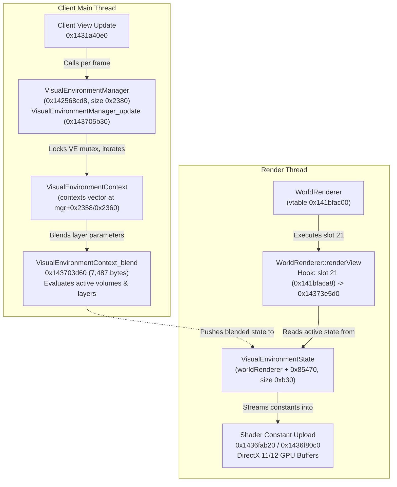

# The Visual Environment and Timelines Reverse Engineering & Render Hook

> [!NOTE]
> **Status**: Reverse engineered from binary dump (`MirrorsEdgeCatalyst_dump_SCY.exe`, Image Base `0x140000000`), verified against Ghidra decompilation and runtime traces. Database annotations added to [`db/annotations/render.yaml`](https://github.com/CodeNameMeteor/Gridnode/blob/main/db/annotations/render.yaml), [`db/annotations/entity.yaml`](https://github.com/CodeNameMeteor/Gridnode/blob/main/db/annotations/entity.yaml), and [`db/annotations/faith.yaml`](https://github.com/CodeNameMeteor/Gridnode/blob/main/db/annotations/faith.yaml).
> **Confirmation Status**: Pure research for now; to be confirmed in game during live gameplay testing.

---

## 1. Executive Summary

Mirror's Edge Catalyst's distinct visual aesthetic—stark architectural whites, vivid primary accents, intense sunlight, realistic atmospheric scattering, and stylized depth of field—is governed by Frostbite's **Visual Environment** and **Timeline** subsystems:

1. **The Visual Environment Subsystem**: Coordinates active visual environment components, volumes, and priority blend stacks into a single contiguous state buffer of `0xb30` (2,864) bytes. It evaluates outdoor sun/sky lighting, tonemapping (HDR exposure and eye adaptation), color grading LUTs, volumetric clouds, wind vector forces, depth of field, vignette, and film grain.
2. **The Rendering Pipeline & Dual-Thread Execution**:
   - **Simulation / Blend (Main Thread)**: Managed by `VisualEnvironmentManager` (singleton `0x142568cd8`, size `0x2380` bytes). During every client view update (`0x1431a40e0`), `VisualEnvironmentManager_update` (`0x143705b30`) locks the VE mutex and calls the multi-layer blending engine `VisualEnvironmentContext_blend` (`0x143703d60`, 7,487 bytes).
   - **Render / Shader Upload (Render Thread)**: The output of the blend drives the `WorldRenderer` instance (vtable `0x141bfac00`), specifically its active state buffer at `worldRenderer + 0x85470`. The render thread consumes this buffer inside `WorldRenderer::renderView` (vtable slot 21: `0x141bfaca8`, original `0x14373e5d0`), passing it directly into the GPU constant buffer upload routines (`0x1436fab20` and `0x1436f80c0`).
3. **Timeline Entities**: Cinematic transitions, moving security doors, freight elevators, and sun position changes are driven by `TimelineEntity` (vtable `0x141beab28`, size `0x490` bytes). API 29 exposes `Timeline_SetTime` (`0x143691120`), whose `force` parameter enables external override of animation tracks even when bound to level logic clocks.

---

## 2. Subsystem Architecture & Class Hierarchy



### 2.1 Pointer Chain to `WorldRenderer` & `VisualEnvironmentState`

In GridNode and trainer implementations, the active `WorldRenderer` and its visual environment state are accessed via global pointer `VisualEnvMain` (`0x142142a48`):

$$\text{pLevelManager} = *\text{reinterpret\_cast}<\text{uintptr\_t}*>(0x142142a48)$$
$$\text{pWorldRenderer} = *((((pLevelManager + 0x50) \to +0x90) \to +0x1c0) \to +0x30)$$
$$\text{pVisualEnvironmentState} = \text{pWorldRenderer} + 0x85470$$

| Pointer Step | Offset | Type | Description |
|---|---|---|---|
| Step 1 | `*0x142142a48` | `LevelContext*` | Root level graphics context pointer |
| Step 2 | `+0x50` | `void*` | View / viewport holder |
| Step 3 | `+0x90` | `void*` | View context manager |
| Step 4 | `+0x1c0` | `void*` | Pipeline coordinator |
| Step 5 | `+0x30` | `WorldRenderer*` | Primary `WorldRenderer` instance (vtable `0x141bfac00`) |
| Destination | `+0x85470` | `VisualEnvironmentState*` | Active 2,864-byte (`0xb30`) visual environment state buffer |

---

## 3. Comprehensive Field Catalog (`VisualEnvironmentState`, `0xb30` Bytes)

The `VisualEnvironmentState` structure spans exactly `0xb30` (2,864) bytes and is divided into 8 functional parameter blocks. All offsets below are relative to `state` (`worldRenderer + 0x85470`):

### 3.1 Outdoor Light Block (`+0x000` to `+0x1d0`, 464 bytes)
Controls direct directional sun lighting, atmospheric bounce, and shadow penumbra.

| Offset in State | Field Offset | Type | Identifier | Description |
|---|---|---|---|---|
| `+0x000` | `+0x00` | `float[3]` | `sunColor` | Sun light RGB emission color (normalized $0.0 \dots 1.0$) |
| `+0x060` | `+0x60` | `float[3]` | `skyColor` | Sky ambient hemisphere color |
| `+0x070` | `+0x70` | `float[3]` | `groundColor` | Ground bounce reflection color |
| `+0x084` | `+0x84` | `float` | `sunRotationX` | Sun elevation angle / pitch in radians |
| `+0x088` | `+0x88` | `float` | `sunRotationY` | Sun azimuth angle / yaw in radians |
| `+0x094` | `+0x94` | `float` | `sunIntensity` | Sun light illuminance intensity (lux) |
| `+0x098` | `+0x98` | `float` | `sunAngularRadius`| Apparent angular radius of sun disk |
| `+0x09c` | `+0x9c` | `float` | `sunDiskIntensity`| Direct brightness multiplier of the rendered sun disk |
| `+0x0a4` | `+0xa4` | `float` | `specularScale` | Sun specular highlight intensity multiplier |
| `+0x0c4` | `+0xc4` | `float` | `sunPenumbra` | Shadow penumbra filter width |
| `+0x118` | `+0x118` | `uint8_t` | `sunEnable` | Sun light master toggle (`1` = enabled, `0` = disabled) |
| `+0x119` | `+0x119` | `uint8_t` | `separateShadowDir`| Separate shadow direction toggle |

### 3.2 Tonemap Block (`+0x1d0` to `+0x330`, 352 bytes)
Controls HDR exposure adaptation, bloom convolution, and filmic curve shoulder/toe.

| Offset in State | Field Offset | Type | Identifier | Description |
|---|---|---|---|---|
| `+0x1d0` | `+0x00` | `float` | `bloomScale` | Bloom glare intensity multiplier |
| `+0x264` | `+0x94` | `float` | `exposureValue` | Baseline target Exposure Value ($\text{EV}_{100}$) |
| `+0x268` | `+0x98` | `float` | `exposureCompensation`| Manual exposure EV compensation bias |
| `+0x274` | `+0xa4` | `float` | `darkAdaptationSpeed` | Adaptation speed entering shadows |
| `+0x278` | `+0xa8` | `float` | `lightAdaptationSpeed`| Adaptation speed entering sunlight |
| `+0x284` | `+0xb4` | `float` | `minEV` | Minimum allowable exposure clamp |
| `+0x288` | `+0xb8` | `float` | `maxEV` | Maximum allowable exposure clamp |
| `+0x290` | `+0xc0` | `int32_t` | `tonemapMethod` | Tonemap curve mode (0 = linear, 1 = filmic) |
| `+0x294` | `+0xc4` | `float` | `blackPoint` | Black clipping point |
| `+0x298` | `+0xc8` | `float` | `whitePoint` | White point ceiling |
| `+0x2a0` | `+0xd0` | `float` | `shoulder` | Filmic S-curve shoulder parameter |
| `+0x2a4` | `+0xd4` | `float` | `toe` | Filmic S-curve toe parameter |
| `+0x318` | `+0x148` | `uint8_t` | `autoExposureEnable`| Automatic eye adaptation toggle |

### 3.3 Color Correction & Grading Block (`+0x330` to `+0x390`, 96 bytes)
Adjusts RGB grading channels and global saturation/contrast.

| Offset in State | Field Offset | Type | Identifier | Description |
|---|---|---|---|---|
| `+0x330` | `+0x00` | `float[3]` | `brightness` | Color grading RGB brightness scale |
| `+0x340` | `+0x10` | `float[3]` | `contrast` | Color grading RGB contrast scale |
| `+0x350` | `+0x20` | `float[3]` | `saturation` | Color grading RGB saturation scale |
| `+0x364` | `+0x34` | `float` | `hue` | Global hue rotation offset (degrees/radians) |
| `+0x370` | `+0x40` | `float` | `maxHDR` | HDR color clamping threshold |
| `+0x374` | `+0x44` | `uint8_t` | `enable` | Color correction master toggle |
| `+0x375` | `+0x45` | `uint8_t` | `colorGradingEnable` | 3D LUT grading evaluation toggle |

### 3.4 Sky and Volumetric Clouds Block (`+0x390` to `+0x6e0`, 848 bytes)
Drives dynamic cloud layers, cloud velocities, and Rayleigh/Mie scattering parameters.

| Offset in State | Field Offset | Type | Identifier | Description |
|---|---|---|---|---|
| `+0x3a0` | `+0x10` | `float[3]` | `cloudColor1` | Lower cloud layer RGB illumination tint |
| `+0x3b0` | `+0x20` | `float[3]` | `cloudColor2` | Upper cloud layer RGB illumination tint |
| `+0x4a8` | `+0x118` | `float` | `sunSizeX` | Sky shader sun billboard X dimension |
| `+0x4ac` | `+0x11c` | `float` | `sunSizeY` | Sky shader sun billboard Y dimension |
| `+0x4e0` | `+0x150` | `float` | `cloudWindDirection`| Wind direction driving cloud motion |
| `+0x4e4` | `+0x154` | `float` | `cloudAltitude1` | Altitude of layer 1 (meters) |
| `+0x4f0` | `+0x160` | `float` | `cloudSpeed1` | Drift speed of layer 1 |
| `+0x520` | `+0x190` | `float` | `cloudAltitude2` | Altitude of layer 2 (meters) |
| `+0x52c` | `+0x19c` | `float` | `cloudSpeed2` | Drift speed of layer 2 |

### 3.5 Global Wind Block (`+0x6e0` to `+0xa50`, 880 bytes)
Drives vertex animation on trees, flags, cranes, and Faith's hair/clothing.

| Offset in State | Field Offset | Type | Identifier | Description |
|---|---|---|---|---|
| `+0x6e4` | `+0x04` | `float` | `windDirection` | Global horizontal wind heading (radians) |
| `+0x6e8` | `+0x08` | `float` | `windStrength` | Baseline wind force / magnitude |
| `+0x6ec` | `+0x0c` | `float` | `variationSpeed` | Frequency of wind gust oscillations |
| `+0x6f0` | `+0x10` | `float` | `variationAmount`| Amplitude of wind gust strength deltas |
| `+0x6f8` | `+0x18` | `float` | `turbulenceSpeed`| High-frequency micro-turbulence rate |
| `+0x6fc` | `+0x1c` | `float` | `turbulenceAmount`| High-frequency turbulence magnitude |

### 3.6 Depth of Field Block (`+0xa50` to `+0xac0`, 112 bytes)
Controls Circle of Confusion (CoC) focus distance, near/far blur radii, and bokeh filters.

| Offset in State | Field Offset | Type | Identifier | Description |
|---|---|---|---|---|
| `+0xa54` | `+0x04` | `float` | `focusDistance` | Focal plane distance from camera (meters) |
| `+0xa58` | `+0x08` | `float` | `blurFactor` | Circle of Confusion radius multiplier |
| `+0xa5c` | `+0x0c` | `float` | `blurAdd` | Additive blur bias |
| `+0xa68` | `+0x18` | `float` | `simpleNearStart` | Near blur transition onset distance |
| `+0xa6c` | `+0x1c` | `float` | `simpleNearEnd` | Near blur full saturation distance |
| `+0xa70` | `+0x20` | `float` | `simpleFarStart` | Far blur onset distance |
| `+0xa74` | `+0x24` | `float` | `simpleFarEnd` | Far blur maximum saturation distance |
| `+0xa88` | `+0x38` | `float` | `spriteNearStart` | Sprite bokeh near onset distance |
| `+0xa8c` | `+0x3c` | `float` | `spriteNearEnd` | Sprite bokeh near saturation distance |
| `+0xa90` | `+0x40` | `float` | `spriteFarStart` | Sprite bokeh far onset distance |
| `+0xa94` | `+0x44` | `float` | `spriteFarEnd` | Sprite bokeh far saturation distance |
| `+0xa98` | `+0x48` | `float` | `spriteMaxBlur` | Maximum sprite bokeh disc diameter |
| `+0xaa8` | `+0x58` | `uint8_t` | `dofEnable` | Depth of field master toggle |

> [!TIP]
> **Sprite Depth of Field Bokeh Patch**: The game's Sprite DOF algorithm can produce harsh quad-clipping artifacts on bright highlights. The cinematic tools avoid this by patching a conditional jump at `0x1435c72ee` to bypass quad culling, producing smooth circular bokeh circles.

### 3.7 Vignette Block (`+0xac0` to `+0xb00`, 64 bytes)
Simulates optical lens peripheral darkening.

| Offset in State | Field Offset | Type | Identifier | Description |
|---|---|---|---|---|
| `+0xac0` | `+0x00` | `float[3]` | `vignetteColor` | Vignette outer edge RGB color |
| `+0xad4` | `+0x14` | `float` | `vignetteScale` | Radial onset distance from screen center |
| `+0xadc` | `+0x1c` | `float` | `vignetteExponent`| Falloff curve exponent (contrast of shadow) |
| `+0xae0` | `+0x20` | `float` | `vignetteOpacity` | Maximum opacity at screen corners ($0.0 \dots 1.0$) |
| `+0xae4` | `+0x24` | `uint8_t` | `vignetteEnable` | Vignette master toggle |

### 3.8 Film Grain Block (`+0xb00` to `+0xb30`, 48 bytes)
Simulates photographic analog film grain noise.

| Offset in State | Field Offset | Type | Identifier | Description |
|---|---|---|---|---|
| `+0xb00` | `+0x00` | `float[3]` | `colorScale` | RGB grain intensity multiplier |
| `+0xb14` | `+0x14` | `float` | `textureScale` | UV tile density across screen resolution |
| `+0xb28` | `+0x28` | `uint8_t` | `enable` | Film grain master toggle |
| `+0xb29` | `+0x29` | `uint8_t` | `linearFiltering`| Bilinear filtering (`1`) vs point sampling (`0`) |

---

## 4. Eliminating Post-Update Flicker via Render Thread Hook

### 4.1 The Mechanism of Flicker
In trainer 1.6.0 and early GridNode implementations, overriding visual environment parameters (e.g. sun angle or exposure) was performed by writing to `worldRenderer + 0x85470` after each simulation tick (`postUpdate`). However, users noticed occasional 1-frame **flickering**:
1. Main Thread runs `VisualEnvironmentManager_update` (`0x143705b30`), which re-evaluates `VisualEnvironmentContext_blend` (`0x143703d60`) using level volumes, overwriting the modified parameters with level defaults.
2. If the Render Thread executes before the next simulation tick's write-back, it submits the default level parameters to the GPU.
3. The resulting frame renders with the original level lighting, producing a single-frame flash.

### 4.2 The Solution: Hooking `WorldRenderer::renderView` (Slot 21)
The definitive, flicker-free hook point is **Slot 21** (`0x141bfaca8`) in the virtual method table of `WorldRenderer` (`0x141bfac00`):
- **Hook Vtable Slot**: `0x141bfaca8` (offset `0xa8` = slot 21)
- **Original Function**: `0x14373e5d0` (`WorldRenderer_renderView`)
- **Execution Thread**: Render Thread (`Render`)

```cpp
using RenderViewFn = void (*)(void* worldRenderer, void* context);
static RenderViewFn g_origRenderView = nullptr;

void hookedRenderView(void* worldRenderer, void* context) {
    const uintptr_t state = reinterpret_cast<uintptr_t>(worldRenderer) + 0x85470;
    
    // 1. Re-apply all active visual environment holds directly before constant upload
    VisualEnvironmentSystem::getInstance().applyHolds(state);

    // 2. Call original function: uploads worldRenderer + 0x85470 to GPU constant buffers
    g_origRenderView(worldRenderer, context);
}
```

Because this hook runs synchronously on the render thread immediately before `FUN_1436fab20` and `FUN_1436f80c0` upload the state buffer to the GPU, **the GPU is guaranteed to receive the mod's overridden values for 100% of rendered frames**, eliminating all write-back flicker.

---

## 5. Timeline Entities & Cinematic Animation Control

### 5.1 `TimelineEntity` Architecture
`TimelineEntity` drives animated tracks over time (doors, security gates, moving cranes, lifts, sun tracks, and camera cuts):
- **Reflected Name**: `TimelineEntity` (Module `Timeline`, Category `Class`, ClassId `694`)
- **Size**: `1,168` bytes (`0x490` bytes)
- **Vtable**: **`0x141beab28`**
- **Factory Function**: `0x14368c060` (allocates `0x490` bytes, initializes entity bus)
- **Constructor**: `0x14368d590` (ctor initializing property connectors and track lists)
- **Destructor**: `0x14368dc60` (frees track keyframe allocations)

### 5.2 Property Connection Map (`+0x30` to `+0x90`)

| Offset | Type | Description |
|---|---|---|
| `+0x30` | `PropertyConnection*` | `StartTime` input connection (`float`) |
| `+0x40` | `PropertyConnection*` | `EndTime` input connection (`float`) |
| `+0x50` | `PropertyConnection*` | `PlaybackSpeed` multiplier connection (`float`) |
| `+0x60` | `PropertyConnection*` | `ExternalTime` input clock connection (`float`). If non-null, external logic drives the time |
| `+0x98` | `float` | **`CurrentTime`** live playback position in seconds |
| `+0x9c` | `float` | Previous frame playback time |
| `+0xa0` | `int32_t` | Playback state (`0` = stopped, `1` = playing, `2` = paused) |
| `+0xb0` | `PropertyConnection*` | `Time` output property (`0xa4fabb19`, `TI_Float32`) |

### 5.3 Timeline Control Interface (`Timeline_SetTime` `0x143691120`)

The game provides a dedicated function to evaluate and scrub timelines:
```cpp
void Timeline_SetTime(TimelineEntity* timeline, float time, bool force);
```

#### Behavioral Details:
1. **The External Time Guard**:
   If `force == false` (`param_3 == 0`) and `*(timeline + 0x60) != nullptr`, the function aborts immediately without modifying time. Level timelines (e.g. gates or automated doors) are connected to external time clocks; passing `force = true` overrides this guard.
2. **Track Evaluation**:
   When forced, `Timeline_SetTime` updates `timeline + 0x98` to `time`, invokes `0x1436903e0` to evaluate keyframe curves across all track groups (`+0x23` and `+0x47`), pushes the updated values into connected entity properties (e.g. door transforms or sun angles), and calls `0x1436922c0` to fire timeline triggers.

---

## 6. GridNode C++ Integration Wrapper

The following class design encapsulates visual environment overrides and timeline manipulation:

```cpp
#pragma once
#include <cstdint>
#include <vector>
#include <mutex>

namespace gridnode::render {

class VisualEnvironmentSystem {
public:
    static VisualEnvironmentSystem& getInstance();

    // Render hook management (slot 21: 0x141bfaca8)
    bool installRenderHook();
    void removeRenderHook();

    // Value hold management
    void setHold(uint32_t offset, const void* data, uint32_t size);
    void releaseHold(uint32_t offset);
    void clearAllHolds();

    // Called on render thread inside hooked WorldRenderer::renderView
    void applyHolds(uintptr_t stateBuffer);

    // Timeline control
    static float getTimelineTime(const void* timelineEntity);
    static bool  setTimelineTime(void* timelineEntity, float seconds, bool force);

private:
    VisualEnvironmentSystem() = default;

    struct ValueHold {
        uint32_t offset;
        std::vector<uint8_t> data;
    };

    std::mutex              m_mutex;
    std::vector<ValueHold>  m_holds;
    uintptr_t               m_origRenderView = 0;
    bool                    m_hookInstalled = false;
};

} // namespace gridnode::render
```

---

## 7. Areas Needing Even More Research

1. **Custom 3D LUT Texture Injection**:
   - Investigate injecting synthetic 3D color lookup tables (`TextureBase` / `TextureResource`) directly into the color grading unit (`worldRenderer + 0xde10` / `FUN_143797400`) to apply custom visual filters without editing `.ebx` files.
2. **Camera View Manager Depth of Field Decoupling**:
   - Decompile `ClientCameraViewManager::updateView` to determine if depth of field focus distance can be dynamically bound to a custom raycast distance for realistic autofocus in photo mode.
3. **Synthetic Timeline Track Synthesis**:
   - Investigate allocating and appending custom `DiceTransformTrackData` keyframe tracks to existing `TimelineEntity` instances at runtime to orchestrate custom cinematic camera pans.
